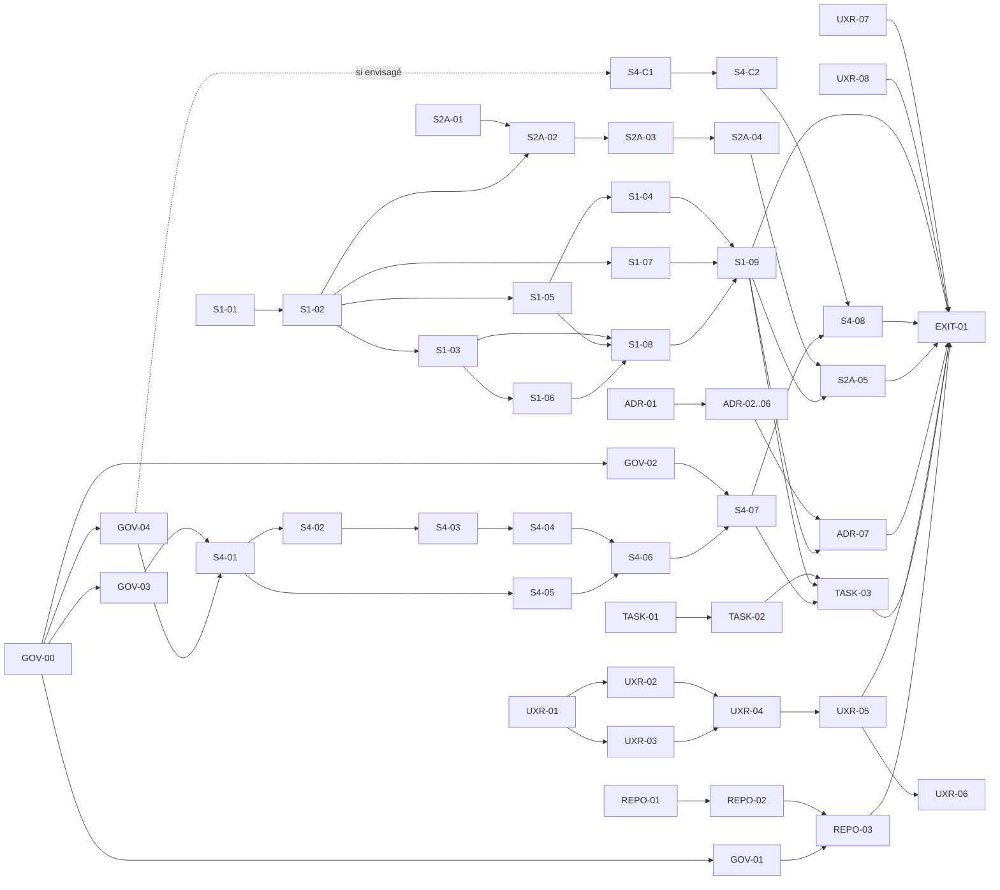

# Phase 0 — Réduction des risques : backlog d'exécution

Statut : proposition, 28/10/2026, à valider par le mainteneur. Aucun ticket n'est démarré.
Source de vérité : [plan.md](../plan.md) v3.2 (§10 Phase 0, §6.3, §6.4, §7.2, §9.2, §3, §16, §17). [specifications.md](../specifications.md) n'est qu'un historique.
Sprint 1 : [sprint-01.md](sprint-01.md).

Ce document **planifie** la phase 0. Il ne contient aucun résultat de spike, d'entretien ou de démarchage : toute valeur mesurée, tout accord et tout entretien seront consignés plus tard, avec leur preuve, aux chemins indiqués.

---

## 1. Hypothèses de planification

| Id | Hypothèse | Statut | Conséquence si fausse |
|---|---|---|---|
| H-P1 | Une seule personne réalise l'essentiel du travail technique et toute la recherche humaine : le mainteneur, aidé d'un agent de code pour les rédactions et les prototypes | Hypothèse, à confirmer (GOV-05) | Répartir les tickets par rôle, recalculer le sprint |
| H-P2 | Les timebox du plan (S1 3 j, S4 3 j, S2a 1 j) sont des **jours-personne de travail focalisé**, pas des jours calendaires | Interprétation du plan | Revoir le calendrier, pas le contenu |
| H-P3 | Les estimations hors spikes sont des ordres de grandeur en jours-personne (j-p), non calibrés sur une vélocité observée (aucun historique : un seul commit) | Hypothèse | Réestimer à la fin du sprint 1 |
| H-P4 | Le temps calendaire de la recherche utilisateur (recrutement, disponibilités) est **inconnu** et ne dépend pas du mainteneur | Fait | La recherche est probablement le chemin critique calendaire (§5) |
| H-P5 | Un spike qui atteint sa timebox s'arrête ; les inconnues restantes sont documentées « non mesuré » et le mainteneur décide explicitement d'une extension ou d'une conclusion partielle. Clore le ticket ne satisfait pas une porte qui exige cette mesure | Règle de travail proposée | — |
| H-P6 | Les artefacts destinés au futur dépôt public (ADR, README, CONTRIBUTING, workflow) sont rédigés **en anglais** (§2 « Dépôt public en anglais ») ; les notes de travail (spikes, exécution, recherche) restent en français comme le plan (en-tête du plan, §16) | Interprétation | Traduire les notes au passage en public |
| H-P7 | Les données personnelles de la recherche (noms, contacts, consentements, notes brutes, enregistrements) restent **hors du dépôt** (§2 « contenu personnel hors du dépôt ») ; le dépôt ne reçoit que des synthèses anonymisées | Règle | — |
| H-P8 | Environnement local observé le 28/10/2026 : SDK .NET 9.0.305, 10.0.102, 10.0.201 ; `docker`, `claude`, `codex` présents dans le `PATH`. Rien n'est encore vérifié au-delà de leur présence | Observation | S1-01 et S4-01 épinglent les versions réellement utilisées |
| H-P9 | Le remote `origin` (`github.com/toregua/hardslice`) est **public** et vide (aucune branche publiée), alors que le plan prévoit un dépôt privé jusqu'à la sortie de 1B. Aucune décision explicite du mainteneur sur cet écart n'est consignée | Observation ; décision ouverte D-01 (GOV-01) | Aucun push avant D-01 ; si le dépôt reste public, aligner le plan et traiter les conséquences sur le contenu publié (D-16, H-P7) |

### Conventions d'artefacts

| Contenu | Chemin |
|---|---|
| Journal des décisions humaines de la phase 0 | `docs/execution/phase-0-decisions.md` |
| Notes de spike (protocole, mesures, conclusion) | `docs/spikes/s1-roslyn.md`, `docs/spikes/s4-runner.md`, `docs/spikes/s2a-conventions.md` |
| Code jetable et données brutes des spikes | `spikes/s1-roslyn/`, `spikes/s4-runner/`, `spikes/s2a-conventions/` (sous-dossier `results/` horodaté par exécution) |
| Recherche (versions anonymisées) | `docs/research/persona.md`, `docs/research/interview-guide.md`, `docs/research/interviews-synthesis.md`, `docs/research/outreach-log.md` |
| Énoncés des tâches du pilote | `bench/tasks/pilot-v1/T1.md`, `bench/tasks/pilot-v1/T2.md`, justification séparée `bench/tasks/pilot-v1/RATIONALE.md` |
| ADR | `docs/adr/0001-*.md` à `docs/adr/0005-*.md` |
| Plan de découpage documentaire | `docs/execution/doc-split-plan.md` |
| Revue de la porte de sortie | `docs/execution/phase-0-exit-review.md` |

Chaque mesure consignée porte : date, machine ou runner, versions (SDK, Roslyn, agent, modèle), SHA du commit, commande exacte, fichier de sortie brut. Les fichiers volumineux (binlogs, transcriptions complètes) peuvent rester hors git si leur empreinte SHA-256 et leur emplacement sont notés (décision D-10).

### Règles d'intégrité des preuves

1. Un modèle, un guide, une checklist ou un brouillon **ne prouve jamais** qu'une action humaine a eu lieu.
2. Un entretien, un accord, un engagement, une revue ou une acceptation d'ADR n'existe que s'il est **attesté par le mainteneur** dans `phase-0-decisions.md` (date, nature, référence anonymisée), et, pour un engagement externe, par une trace écrite du tiers conservée hors dépôt.
3. Un agent peut préparer un ADR, une note ou un énoncé ; il ne le marque jamais `accepted`, `figé` ou `conclu`.
4. Aucun résultat de spike n'est écrit avant la mesure. Une question non mesurée est notée « non mesuré » avec sa raison, jamais estimée silencieusement. Un tel statut peut clore un ticket timeboxé, mais il laisse fermée toute porte qui exige cette mesure.
5. Aucun montant financier n'est inventé : le budget du pilote est une décision humaine (GOV-02).

---

## 2. Epics

| Epic | Livrable du plan (§10 Phase 0) | Tickets |
|---|---|---|
| **GOV** — Décisions et gouvernance de la phase | Préalables humains et financiers ; critère « coût estimé du pilote ≤ budget » | GOV-00 à GOV-05 |
| **S1** — Spike Roslyn (timebox 3 j) | S1 Roslyn | S1-01 à S1-09 |
| **S4** — Spike runner (timebox globale 3 j, Codex conditionnel inclus) | S4 Runner | S4-01 à S4-08, S4-C1, S4-C2 |
| **S2A** — Conventions minimales (timebox 1 j) | S2a | S2A-01 à S2A-05 |
| **UXR** — Recherche utilisateur | Note persona, guide, ≥ 3 entretiens, démarchage design partner et gardien | UXR-01 à UXR-08 |
| **TASK** — Énoncés du pilote | Énoncés des 2 tâches | TASK-01 à TASK-03 |
| **ADR** — Décisions d'architecture | 5 ADR MADR acceptés | ADR-01 à ADR-07 |
| **REPO** — Squelette et CI | Squelette du dépôt, CI de build | REPO-01 à REPO-03 |
| **DOC** — Documentation | Bannière du spec v2, plan de découpage §16 | DOC-01, DOC-02 |
| **EXIT** — Porte de sortie | Critère de sortie et go/no-go | EXIT-01 |

Priorités : **P1** = sur le chemin critique ou conditionne un no-go ; **P2** = exigé par la porte de sortie, hors chemin critique ; **P3** = utile ou exigé après la phase 0 (avant 1A/1B/4), lancé maintenant à cause de sa latence.

---

## 3. Tickets détaillés

### Epic GOV — Décisions et gouvernance

#### GOV-00 — Le journal des décisions de la phase 0 existe et sert de registre de preuves humaines
- **Type** : documentation — **Priorité** : P1 — **Owner** : [Mainteneur] (rédaction possible par [Agent])
- **Estimation** : 0,1 j-p — **Dépendances** : aucune
- **Résultat attendu** : `docs/execution/phase-0-decisions.md` avec un gabarit d'entrée (id, date, décideur, décision, alternatives écartées, preuve, tickets débloqués) et la liste des décisions ouvertes du §10.
- **Périmètre** : le fichier et son gabarit. **Hors périmètre** : prendre une décision.
- **Étapes** : 1. créer le fichier ; 2. reprendre les identifiants D-01 à D-17 du §10 avec le statut « ouverte » ; 3. indiquer que seules les entrées signées par le mainteneur font foi.
- **Critères d'acceptation** : le fichier existe ; chaque décision du §10 y figure avec le statut « ouverte » ; aucune entrée n'est pré-remplie avec une décision.
- **Preuves** : `docs/execution/phase-0-decisions.md`.
- **Risques** : registre non tenu à jour → preuves dispersées.
- **Porte** : support de toutes les preuves humaines de EXIT-01.

#### GOV-01 — La visibilité du dépôt avant le premier push est décidée et consignée
- **Type** : décision — **Priorité** : P1 — **Owner** : [Mainteneur]
- **Estimation** : < 30 min — **Dépendances** : GOV-00
- **Résultat attendu** : entrée D-01 qui choisit explicitement entre : (a) rendre le remote privé jusqu'à la sortie de 1B, conformément au §10 et au §16 ; ou (b) le conserver public mais non annoncé dès la phase 0, avec README « experimental », après alignement du plan. Aucune option n'est présumée par ce backlog.
- **Périmètre** : constater la visibilité réelle, décider, puis consigner les conséquences. Si l'option publique est retenue, le plan de travail en français, le spec v2 et les notes de phase 0 deviennent publics au premier push ; les données de recherche restent hors dépôt (H-P7) et D-16 doit être tranchée. **Hors périmètre** : protections de branche et CODEOWNERS (phase 4).
- **Étapes** : 1. noter la visibilité (`gh repo view --json visibility`) ; 2. choisir et consigner l'une des deux options ; 3. si l'option publique est retenue, aligner `plan.md` avant le premier push et trancher D-16 ; 4. si l'option privée est retenue, modifier la visibilité du remote avant le premier push.
- **Critères d'acceptation** : D-01 est signée par le mainteneur, la visibilité effective correspond à la décision et tout écart résiduel avec le plan est nul avant le premier push.
- **Preuves** : entrée D-01.
- **Risques** : publication involontaire de contenu personnel ou de données de recherche (R-06).
- **Porte** : bloque tout premier push et REPO-03.

#### GOV-02 — Le budget financier maximal du pilote est fixé par une décision humaine
- **Type** : décision — **Priorité** : P1 (**bloquante** pour la porte de sortie) — **Owner** : [Mainteneur / financeur]
- **Estimation** : < 1 h de décision ; latence inconnue — **Dépendances** : GOV-00. **Recommandation** : décider **avant** de lire le résultat de S4-07 pour éviter d'ajuster le budget à l'estimation.
- **Résultat attendu** : D-02 consignée : montant maximal en dollars pour le pilote de phase 3 (24 tentatives au plus, §9.3), devise, ce qu'il couvre (tokens du pilote seuls, ou aussi répétitions et contrôle de manipulation) et ce qu'il exclut.
- **Périmètre** : le montant et sa couverture. **Hors périmètre** : la grille de prix figée (pré-enregistrement, phase 3) ; les coûts des runs 1A et phase 2 (voir D-02b).
- **Étapes** : 1. préciser la couverture ; 2. fixer le montant ; 3. consigner.
- **Critères d'acceptation** : D-02 contient un montant explicite saisi par le mainteneur et sa couverture. **Aucun montant n'est proposé par ce backlog.**
- **Preuves** : entrée D-02.
- **Risques** : budget fixé après l'estimation (ancrage) ; budget ambigu sur la couverture.
- **Porte** : critère de sortie « coût estimé du pilote ≤ budget » (EXIT-01).

#### GOV-03 — Une enveloppe de dépense et des accès dédiés permettent d'exécuter S4
- **Type** : décision — **Priorité** : P1 pour S4 — **Owner** : [Mainteneur]
- **Estimation** : < 1 h + provisionnement — **Dépendances** : GOV-00
- **Résultat attendu** : D-03 consignée : dépense maximale autorisée pour les runs de S4 (et S4-C2 si Codex), mode d'authentification de Claude Code dans un conteneur (clé API dédiée ou autre), plafond de dépense configuré côté fournisseur si disponible, règle de rotation ou révocation de la clé après le spike.
- **Périmètre** : accès et enveloppe du spike. **Hors périmètre** : budget du pilote (GOV-02).
- **Étapes** : 1. choisir le mode d'authentification ; 2. fixer l'enveloppe ; 3. provisionner la clé hors dépôt ; 4. consigner sans secret.
- **Critères d'acceptation** : D-03 contient un montant décidé par le mainteneur et le mode d'authentification ; aucun secret n'apparaît dans le dépôt (`git grep` des préfixes de clé vide).
- **Preuves** : entrée D-03.
- **Risques** : fuite de clé dans un log de run ; dépassement de l'enveloppe pendant la répétition à blanc.
- **Porte** : bloque S4-01.

#### GOV-04 — Codex est explicitement envisagé ou écarté pour la phase 0
- **Type** : décision — **Priorité** : P2 — **Owner** : [Mainteneur]
- **Estimation** : < 30 min — **Dépendances** : GOV-00
- **Résultat attendu** : D-04 : « Codex envisagé » (S4-C1 et S4-C2 entrent dans le backlog actif et S4-01 réalloue la timebox globale de 3 jours sans supprimer une mesure obligatoire) ou « non envisagé en phase 0 » (S4-C1, S4-C2 restent dormants ; la question revient au début de la phase 2, §17). Toute extension au-delà de 3 jours exige une révision explicite du plan ; elle n'est pas implicite.
- **Périmètre** : la décision. **Hors périmètre** : l'adaptateur Codex (phase 2 ou E5).
- **Critères d'acceptation** : D-04 consignée ; si Codex est envisagé, la répartition des 3 jours entre S4-01..08 et S4-C1/C2 est écrite dans le protocole S4 avant les runs.
- **Preuves** : entrée D-04.
- **Risques** : Codex intégré par défaut ou ajouté sans arbitrage, ce qui ferait dépasser la timebox du plan.
- **Porte** : conditionne S4-C1 et S4-C2.

#### GOV-05 — La capacité réelle et la cadence de sprint sont confirmées
- **Type** : décision — **Priorité** : P2 — **Owner** : [Mainteneur]
- **Estimation** : < 30 min — **Dépendances** : aucune
- **Résultat attendu** : D-05 : jours-personne disponibles par sprint, durée du sprint, temps hebdomadaire réservé à la recherche humaine, présence ou non d'autres contributeurs (relecteur d'ADR, relecteur des énoncés).
- **Critères d'acceptation** : D-05 consignée ; `sprint-01.md` ajusté selon sa table de capacité.
- **Preuves** : entrée D-05.
- **Risques** : capacité surestimée → sprint 1 partiel.
- **Porte** : aucune ; conditionne le dimensionnement des sprints.

---

### Epic S1 — Spike Roslyn (timebox 3 j-p)

Objet : déterminer, mesures à l'appui, si HS016 est détectable par opération ou par symbole, à travers les assemblies, en IDE et en CLI, dans les budgets du §6.4, avec un `.globalconfig` par niveau livré par paquet ; fixer la frontière analyseur / `dotnet hardslice check` et une première calibration de l'exposition HS016. **Aucun résultat n'est présumé.** Le code du spike est jetable et n'est pas l'implémentation de la phase 1A.

#### S1-01 — Le protocole S1 est reproductible et approuvé avant toute mesure
- **Type** : spike — **Priorité** : P1 — **Owner** : [Mainteneur] (rédaction [Agent] possible)
- **Timebox** : 0,25 j — **Dépendances** : GOV-00 ; D-06 (solutions OSS) et D-07 (IDE) tranchées dans ce ticket
- **Résultat attendu** : section « Protocole » de `docs/spikes/s1-roslyn.md` et `spikes/s1-roslyn/README.md`.
- **Périmètre** : sept questions expérimentales, Q1 à Q7, correspondant respectivement aux tickets S1-02 à S1-08 : détection dans une compilation, inter-assemblies, IDE/CLI, packaging et précédence, performance, exposition, frontière analyseur/`check`. S1-09 synthétise ces réponses ; ce n'est pas une huitième question. Le protocole précise pour chaque question la méthode, les mesures, les budgets cibles du §6.4 et l'artefact. Il épingle aussi les versions (SDK, `Microsoft.CodeAnalysis.CSharp` aligné sur le SDK 10.0.1xx, annexe A.3), la machine, la **grosse solution OSS** et les dépôts en slices de calibration. **Hors périmètre** : écrire l'analyseur de production.
- **Étapes** : 1. lister Q1–Q7 et, pour chacune, la mesure, la commande, le budget et l'artefact ; 2. présélectionner les solutions et vérifier qu'elles compilent ; 3. épingler les versions ; 4. soumettre le choix au mainteneur.
- **Critères d'acceptation** : chaque question a une méthode, une commande et un artefact attendu ; les solutions retenues compilent avec le SDK épinglé (log de build joint) ; le critère « grosse » est fixé avant mesure ; D-06 et D-07 consignées.
- **Preuves** : `docs/spikes/s1-roslyn.md#protocole`, `spikes/s1-roslyn/results/<date>/build-baseline.log`.
- **Risques** : grosse solution non compilable en .NET 10 (R-11) ; critère « grosse » fixé après coup.
- **Porte** : préalable à S1-02..S1-09.

#### S1-02 — Q1 : on sait si HS016 est détectable par opération ou par symbole dans une compilation, sur les formes de la matrice 1A
- **Type** : spike — **Priorité** : P1 — **Owner** : [Mainteneur + Agent]
- **Timebox** : 0,5 j — **Dépendances** : S1-01
- **Résultat attendu** : prototype d'analyseur HS016 (`RegisterOperationAction` / `RegisterSymbolAction`, pas d'analyseur de fin de compilation, §6.1) avec classification par namespace codée en dur pour le spike, et une fixture qui exerce les formes : référence directe, alias, `global using`, argument de type générique, `typeof`, types partiels, attribut, compilation cassée, code généré réel et faux marquage `[GeneratedCode]`.
- **Périmètre** : détection dans un même assembly ; table « forme → détecté / non détecté / faux positif / crash AD0001 ». **Hors périmètre** : message de diagnostic exemplaire (1A), fiches, tests complets de la matrice §6.5 (1A).
- **Étapes** : 1. créer la fixture ; 2. écrire le prototype ; 3. exécuter `dotnet build` sur la fixture ; 4. remplir la table avec les diagnostics observés ; 5. noter chaque écart.
- **Critères d'acceptation** : chaque forme listée a un résultat observé et la sortie de build correspondante ; tout faux positif ou crash est consigné, pas corrigé silencieusement ; les opérations ou symboles qui ne permettent pas la détection sont nommés.
- **Preuves** : `spikes/s1-roslyn/` (prototype, fixture), `spikes/s1-roslyn/results/<date>/forms.md`, logs de build.
- **Risques** : forme non couverte par une action par opération (R-02) ; temps passé à polir le prototype.
- **Porte** : alimente le no-go technique « faux positif connu » (S1-09).

#### S1-03 — Q2 : on sait si HS016 détecte une violation lorsque le type cible vient d'un autre assembly
- **Type** : spike — **Priorité** : P1 — **Owner** : [Mainteneur + Agent]
- **Timebox** : 0,25 j — **Dépendances** : S1-02
- **Résultat attendu** : fixture multi-projets (slice A dans un projet, slice B dans un projet référencé ; référence de projet puis référence de paquet local) et résultat observé de la détection sur symboles de métadonnées.
- **Périmètre** : `ProjectReference` et `PackageReference` vers un assembly compilé. **Hors périmètre** : multi-targeting (1B).
- **Étapes** : 1. fixture ; 2. build CLI ; 3. table des résultats ; 4. noter les informations perdues entre source et métadonnées (namespace, partiels, attributs).
- **Critères d'acceptation** : la table indique pour chaque configuration détecté / non détecté avec le log de build ; toute dépendance à une information indisponible en métadonnées est nommée.
- **Preuves** : `spikes/s1-roslyn/results/<date>/cross-assembly.md`, logs.
- **Risques** : classification qui exige la vue de la solution → bascule vers `check` (S1-08).
- **Porte** : Q2 de S1-09.

#### S1-04 — Q3 : on connaît le comportement de HS016 dans l'IDE retenu et en CLI, à partir d'un paquet local
- **Type** : spike — **Priorité** : P1 — **Owner** : [Mainteneur] (manipulation IDE humaine)
- **Timebox** : 0,25 j — **Dépendances** : S1-02, S1-05 (paquet local) ; D-07
- **Résultat attendu** : comparaison IDE / `dotnet build` / `dotnet build -warnaserror` : présence du diagnostic, ID, emplacement, sévérité, délai d'apparition observé, rechargement après modification de la configuration, analyseur chargé depuis le paquet (pas depuis une `ProjectReference`).
- **Périmètre** : l'IDE retenu par D-07 (candidat par défaut : VS Code + C# Dev Kit, à confirmer) et la CLI. **Hors périmètre** : autres IDE, test de latence statistique (S1-06).
- **Étapes** : 1. installer le paquet local dans la fixture ; 2. ouvrir dans l'IDE ; 3. introduire puis retirer une violation ; 4. changer le niveau d'analyse ; 5. capturer.
- **Critères d'acceptation** : pour chaque scénario, résultat IDE et CLI côte à côte, avec captures d'écran datées et logs ; versions de l'IDE et de l'extension notées ; divergences listées.
- **Preuves** : `spikes/s1-roslyn/results/<date>/ide-cli.md`, captures `ide-*.png`.
- **Risques** : cache d'analyseurs de l'IDE qui masque un changement ; IDE non représentatif du persona.
- **Porte** : Q3 de S1-09.

#### S1-05 — Q4 : on sait livrer un `.globalconfig` par niveau dans un paquet et on connaît la précédence effective
- **Type** : spike — **Priorité** : P1 — **Owner** : [Mainteneur + Agent]
- **Timebox** : 0,5 j — **Dépendances** : S1-02
- **Résultat attendu** : paquet local de prototype contenant `HardSlice.Analyzers.level-1.globalconfig`, sélectionné par `<HardSliceAnalysisLevel>1</HardSliceAnalysisLevel>` via `GlobalAnalyzerConfigFiles` (§6.3, annexe A.3), et table de précédence observée.
- **Périmètre** : cas (a) sans propriété : warning ; (b) niveau 1 : erreur ; (c) `.globalconfig` utilisateur qui rétrograde ; (d) `.editorconfig` utilisateur qui rétrograde ; (e) `-warnaserror` ; (f) `-nowarn` ; (g) niveau inconnu ; (h) propriété définie hors racine. Pour chaque cas : comportement **attendu par le plan** et comportement **observé**. **Hors périmètre** : détection par `verify` (phase 4), publication nuget.org (1B).
- **Étapes** : 1. structurer le paquet (`build`/`buildTransitive`) ; 2. `dotnet pack` vers un flux local ; 3. exécuter les huit cas ; 4. remplir la table.
- **Critères d'acceptation** : les huit cas ont un résultat observé et un log ; tout écart avec le §6.3 est signalé comme écart, pas réinterprété ; la commande de pack et la structure du paquet sont reproductibles depuis le README du spike.
- **Preuves** : `spikes/s1-roslyn/results/<date>/globalconfig-precedence.md`, `.nupkg` du spike (empreinte notée), logs.
- **Risques** : comportement différent entre IDE et CLI (croisé avec S1-04).
- **Porte** : décision « packaging du `.globalconfig` » (§17) dans S1-09.

#### S1-06 — Q5 : le coût de HS016 sur une grosse solution est mesuré contre les budgets du §6.4
- **Type** : spike — **Priorité** : P1 — **Owner** : [Mainteneur + Agent]
- **Timebox** : 0,5 j — **Dépendances** : S1-01, S1-02, S1-03
- **Résultat attendu** : (1) part des analyseurs HS dans le build via `-p:ReportAnalyzer=true` et binlog, sur la grosse solution (budget ≤ 5 % du temps de compilation) ; (2) benchmark dédié `CompilationWithAnalyzers` sur compilation fixe, warm-up, ≥ 10 répétitions, médiane par document (budget ≤ 20 ms).
- **Périmètre** : la grosse solution OSS de S1-01, avec une configuration de classification qui exerce le chemin de détection (à documenter, car une solution non organisée en slices ne déclenche pas forcément le code coûteux). **Hors périmètre** : `check` sur la mini-application (≤ 30 s à chaud, ≤ 90 s à froid) : **non mesurable en phase 0**, la mini-application n'existe qu'en 1A ; ce budget est noté « reporté en 1A ».
- **Étapes** : 1. build de référence sans analyseur HS ; 2. build avec `ReportAnalyzer` et binlog ; 3. benchmark dédié ; 4. table mesure / budget / verdict.
- **Critères d'acceptation** : les deux mesures de phase 0 sont présentes avec leur commande, la machine et les versions ; verdict « respecté » ou « non respecté » par budget. Si leur exécution est impossible dans la timebox, « non mesuré » est consigné avec sa cause, mais S1-09 ne peut pas ouvrir la porte de phase 0. Le budget `check` porte explicitement la mention « reporté en 1A » puisqu'il n'est pas mesurable avant la mini-application.
- **Preuves** : `spikes/s1-roslyn/results/<date>/perf.md`, CSV du benchmark, binlog (ou empreinte et emplacement si hors git).
- **Risques** : bruit de mesure sur poste personnel ; configuration de classification peu représentative.
- **Porte** : no-go technique « dans les budgets » (S1-09).

#### S1-07 — Q6 : une première calibration du nombre d'opportunités HS016 est disponible
- **Type** : spike — **Priorité** : P1 — **Owner** : [Mainteneur]
- **Timebox** : 0,25 j — **Dépendances** : S1-02, S1-01 (dépôt en slices)
- **Résultat attendu** : compteur interne « opportunités évaluées » / « diagnostics émis » (§6.1) sur la fixture et sur au moins un dépôt OSS organisé en slices ; triage de **tous** les diagnostics émis (vrai / faux positif, justification) ; proposition argumentée d'un seuil minimal d'opportunités pour le corpus de 1B (200 est la cible initiale du §10, pas un seuil imposé).
- **Périmètre** : première calibration. **Hors périmètre** : corpus externe sur ≥ 2 solutions (1B).
- **Étapes** : 1. instrumenter le prototype ; 2. exécuter ; 3. trier ; 4. rédiger la proposition de seuil.
- **Critères d'acceptation** : nombres bruts publiés par dépôt ; chaque diagnostic trié avec justification ; la proposition de seuil cite les nombres observés.
- **Preuves** : `spikes/s1-roslyn/results/<date>/exposure.md`, liste de triage.
- **Risques** : dépôt en slices trop petit pour être informatif ; classification de namespace mal configurée qui gonfle les opportunités.
- **Porte** : décision « seuil d'exposition HS016 » (§17).

#### S1-08 — Q7 : la frontière entre analyseur Roslyn et `dotnet hardslice check` est décidée sur la base des observations
- **Type** : décision — **Priorité** : P1 — **Owner** : [Mainteneur]
- **Timebox** : 0,25 j — **Dépendances** : S1-02, S1-03, S1-05, S1-06
- **Résultat attendu** : table « contrôle → analyseur / `check` / non retenu », avec justification issue des observations (contrôle exigeant une vue de la solution, complétude de la classification, cohérence de configuration entre projets, dédoublonnage multi-TFM, etc.).
- **Périmètre** : la frontière pour HS016 et la configuration S2a. **Hors périmètre** : implémentation de `check` (1A).
- **Critères d'acceptation** : chaque contrôle listé a une affectation et une justification qui renvoie à un artefact de S1-02..S1-06 ; aucun analyseur de fin de compilation n'est retenu dans le noyau sans le signaler comme écart au §6.1.
- **Preuves** : section « Frontière » de `docs/spikes/s1-roslyn.md`.
- **Risques** : frontière décidée par préférence plutôt que par mesure.
- **Porte** : décision §17 ; entrée de S2A-05 et d'ADR-02 (0001).

#### S1-09 — La note S1 est conclue avec ses mesures et une décision go / no-go technique est prise
- **Type** : décision — **Priorité** : P1 — **Owner** : rédaction [Mainteneur + Agent], décision [Mainteneur]
- **Timebox** : 0,25 j — **Dépendances** : S1-02 à S1-08
- **Résultat attendu** : section « Conclusion » de `docs/spikes/s1-roslyn.md` : réponse à Q1–Q7 avec renvoi à l'artefact, table budgets (respecté / non respecté / non mesuré), faux positifs connus, inconnues restantes, recommandation, puis **décision du mainteneur** consignée (D-S1) : go, go sous conditions non bloquantes listées, ou **no-go technique → repenser le mécanisme** (§10).
- **Périmètre** : conclusion et décision. **Hors périmètre** : réécriture du plan.
- **Critères d'acceptation** : chaque question a une réponse sourcée ou « non mesuré » motivé. Un résultat négatif observé est une mesure valide, mais une mesure obligatoire absente laisse la porte de phase 0 fermée. Un faux positif connu non résolu, l'impossibilité démontrée de l'éviter ou un budget mesurable non respecté impose un **no-go technique** ; aucune acceptation humaine ne peut le convertir en go. Un go sous conditions est réservé aux inconnues non bloquantes. La décision est signée dans `phase-0-decisions.md`.
- **Preuves** : `docs/spikes/s1-roslyn.md#conclusion`, entrée D-S1.
- **Risques** : biais de confirmation ; dépassement de timebox non déclaré.
- **Porte** : **go/no-go technique de la phase 0** ; critère de sortie « note S1 conclue avec mesures ».

---

### Epic S4 — Spike runner (timebox globale 3 j-p, Codex conditionnel inclus)

Objet : prouver ou réfuter qu'un run Claude Code headless peut s'exécuter dans un conteneur neuf, sans configuration utilisateur, avec les hooks et skills du projet actifs (et pas `--bare`, §9.2), que le hook Stop se déclenche en mode `-p`, et que le temps, les tokens par type, le coût et les appels d'outils sont capturables ; chiffrer les plafonds par run et le coût estimé du pilote. **Les options CLI citées sont des candidates à vérifier dans la documentation et la version épinglées le jour du spike** (faits volatils, annexe A.1). Le hook utilisé est un hook de test, pas l'adaptateur `dotnet hardslice hook claude stop` (phase 2).

Les timeboxes indiquées dans les tickets S4-01 à S4-08 sont celles de la variante sans Codex. Si D-04 retient Codex, le protocole S4 applique l'allocation de remplacement ci-dessous. Les deux variantes totalisent 3 jours et conservent toutes les mesures obligatoires.

| Ticket | Sans Codex | Avec Codex |
|---|---:|---:|
| S4-01 | 0,5 j | 0,375 j |
| S4-02 | 0,25 j | 0,125 j |
| S4-03 | 0,25 j | 0,125 j |
| S4-04 | 0,5 j | 0,375 j |
| S4-05 | 0,5 j | 0,375 j |
| S4-06 | 0,5 j | 0,375 j |
| S4-07 | 0,25 j | 0,25 j |
| S4-08 | 0,25 j | 0,25 j |
| S4-C1 | — | 0,25 j |
| S4-C2 | — | 0,5 j |
| **Total** | **3 j** | **3 j** |

#### S4-01 — Un conteneur neuf, versionné et reproductible exécute Claude Code en mode headless
- **Type** : spike / infrastructure — **Priorité** : P1 — **Owner** : [Mainteneur + Agent]
- **Timebox sans Codex** : 0,5 j ; avec Codex : 0,375 j — **Dépendances** : GOV-03, GOV-04
- **Résultat attendu** : section « Protocole » de `docs/spikes/s4-runner.md`, puis `spikes/s4-runner/Dockerfile` (SDK .NET épinglé, version de Claude Code épinglée) et script de lancement qui crée un `HOME` vide et un worktree neuf au commit voulu, avec injection de la clé hors image ; un run `-p` trivial aboutit. Le protocole répartit la timebox globale de 3 jours et, si D-04 retient Codex, réserve 0,75 jour à S4-C1/C2 sans supprimer de mesure obligatoire.
- **Périmètre** : image, lancement, un run trivial. **Hors périmètre** : runner `bench/run` durci (phase 2), Codex.
- **Étapes** : 1. écrire et faire valider le protocole, les questions, mesures obligatoires et l'allocation des 3 jours ; 2. écrire le Dockerfile et le script ; 3. exécuter le run trivial ; 4. noter digest d'image et versions.
- **Critères d'acceptation** : le protocole est validé avant le premier run payant ; deux constructions successives produisent le même environnement déclaré (versions affichées identiques) ; le run trivial se termine avec code de sortie 0 ; la clé n'apparaît ni dans l'image (`docker history`) ni dans les logs.
- **Preuves** : `docs/spikes/s4-runner.md#protocole`, `spikes/s4-runner/Dockerfile`, `spikes/s4-runner/results/<date>/run-00-trivial/` (log, versions, digest).
- **Risques** : authentification impossible sans interaction ; fuite de secret.
- **Porte** : préalable à S4-02..S4-06.

#### S4-02 — L'absence de toute configuration et mémoire utilisateur est démontrée
- **Type** : spike — **Priorité** : P1 — **Owner** : [Mainteneur + Agent]
- **Timebox sans Codex** : 0,25 j ; avec Codex : 0,125 j — **Dépendances** : S4-01
- **Résultat attendu** : preuve que le run ne charge que les sources de configuration du projet : `HOME` neuf, aucun `~/.claude`, aucune mémoire utilisateur, aucune variable d'environnement de configuration héritée ; mécanisme de restriction des sources (option candidate à vérifier) documenté.
- **Périmètre** : sources de configuration de Claude Code. **Hors périmètre** : Codex.
- **Étapes** : 1. inventaire du conteneur avant run ; 2. run avec un marqueur dans une configuration utilisateur **volontairement plantée** pour vérifier qu'elle est ignorée ; 3. inspection de la transcription ou du log de débogage.
- **Critères d'acceptation** : le marqueur utilisateur planté n'apparaît pas dans la transcription ni dans les effets ; l'inventaire et la commande exacte sont publiés ; `--bare` n'est pas utilisé.
- **Preuves** : `spikes/s4-runner/results/<date>/run-01-isolation/`.
- **Risques** : source de configuration non documentée chargée quand même.
- **Porte** : exigence d'isolation §9.2.

#### S4-03 — Les hooks et skills du projet sont actifs en mode headless
- **Type** : spike — **Priorité** : P1 — **Owner** : [Mainteneur + Agent]
- **Timebox sans Codex** : 0,25 j ; avec Codex : 0,125 j — **Dépendances** : S4-02
- **Résultat attendu** : fixture `spikes/s4-runner/fixture/` avec `.claude/settings.json` déclarant un hook sonde qui écrit un marqueur, et `.claude/skills/probe/SKILL.md` ; preuve que les deux sont chargés en `-p`.
- **Périmètre** : chargement des hooks et skills du projet. **Hors périmètre** : les 2 skills du produit (phase 2).
- **Critères d'acceptation** : le fichier marqueur du hook existe après le run ; la transcription montre l'usage ou la découverte de la skill sonde ; la commande exacte est publiée.
- **Preuves** : `spikes/s4-runner/results/<date>/run-02-hooks-skills/`.
- **Risques** : confiance du projet requise de façon interactive.
- **Porte** : exigence §10 « avec hooks et skills du projet actifs ».

#### S4-04 — Le hook Stop se déclenche réellement en mode `-p` et peut empêcher l'agent de rendre la main
- **Type** : spike — **Priorité** : P1 — **Owner** : [Mainteneur + Agent]
- **Timebox sans Codex** : 0,5 j ; avec Codex : 0,375 j — **Dépendances** : S4-03
- **Résultat attendu** : run réel sur une fixture .NET minimale (fixture de développement, distincte des tâches du pilote) où l'agent laisse un build rouge ; un hook Stop de test exécute `dotnet build`, bloque (code ou décision de blocage selon la doc datée) avec un message, l'agent reprend, corrige, puis le hook laisse passer.
- **Périmètre** : déclenchement, blocage, reprise, champ `stop_hook_active` observé, durée du hook ; observation du comportement quand le hook dépasse son timeout configuré. **Hors périmètre** : garde anti-boucle HardSlice à 5 (phase 2), `dotnet hardslice check`.
- **Étapes** : 1. fixture ; 2. script de hook journalisé ; 3. run ; 4. variante timeout ; 5. extraction des événements.
- **Critères d'acceptation** : le journal du hook montre au moins un blocage suivi d'une reprise de l'agent et d'un arrêt autorisé, horodatés ; ou, si le hook ne se déclenche pas, ce résultat est consigné tel quel avec la commande et la version ; le comportement de timeout est décrit d'après observation.
- **Preuves** : `spikes/s4-runner/results/<date>/run-03-stop-hook/` (transcription, journal du hook).
- **Risques** : Stop non déclenché en `-p` (R-03) : remet en cause le bras B/C tel que défini et doit remonter en décision.
- **Porte** : question explicite du §10 ; entrée de S4-08.

#### S4-05 — Temps, tokens par type, coût et appels d'outils sont capturés automatiquement pour chaque run
- **Type** : spike — **Priorité** : P1 — **Owner** : [Agent + Mainteneur]
- **Timebox sans Codex** : 0,5 j ; avec Codex : 0,375 j — **Dépendances** : S4-01 (peut avancer en parallèle de S4-02..04)
- **Résultat attendu** : script qui produit `run-metrics.json` par run : temps mur, tokens d'entrée, de sortie, de lecture et d'écriture de cache, coût rapporté par l'outil s'il existe, coût recalculé selon une grille de prix datée et sourcée, nombre et liste des appels d'outils, code de sortie, événements du hook.
- **Périmètre** : extraction depuis la sortie structurée de l'agent (format candidat à vérifier) et depuis le chronométrage du lanceur. **Hors périmètre** : métriques du holdout (phase 3), `temps_diagnostic_vers_vert` (exige HS016 réelle).
- **Critères d'acceptation** : sur les runs S4-01..S4-04, chaque champ est rempli ou marqué « indisponible » avec la raison ; le coût recalculé et le coût rapporté (s'il existe) sont comparés et l'écart publié ; la grille de prix porte sa date et sa source.
- **Preuves** : `spikes/s4-runner/metrics/`, `spikes/s4-runner/results/<date>/*/run-metrics.json`.
- **Risques** : types de tokens non exposés séparément ; coût rapporté non fondé sur la même grille.
- **Porte** : unité de coût du §9.3.

#### S4-06 — Une répétition à blanc chiffre la variabilité d'un run complet
- **Type** : spike — **Priorité** : P1 — **Owner** : [Mainteneur]
- **Timebox sans Codex** : 0,5 j ; avec Codex : 0,375 j — **Dépendances** : S4-04, S4-05, D-08 (tâche proxy)
- **Résultat attendu** : r runs complets (r fixé dans le protocole avant exécution, dans l'enveloppe D-03) de la procédure entière — conteneur neuf, prompt, hook Stop, capture des métriques, copie des sorties hors conteneur — sur une **tâche proxy** de taille comparable à celle visée pour le pilote.
- **Périmètre** : procédure et mesures. **Hors périmètre** : runs sur les énoncés du pilote (sauf décision contraire D-08), bras C/C− (pas d'analyseur HS016 réel en phase 0), holdout.
- **Critères d'acceptation** : r runs exécutés ou l'écart justifié ; table par run (temps, tokens par type, coût recalculé, appels d'outils, succès de la procédure) ; médiane, min, max ; toute panne classée externe ou non selon la définition du §9.2.
- **Preuves** : `spikes/s4-runner/results/<date>/dry-run/`, `dry-run-summary.md`.
- **Risques** : proxy non représentatif (R-09) ; contamination si on itère sur les vrais énoncés (R-16).
- **Porte** : entrée de S4-07.

#### S4-07 — Les plafonds par run et le coût estimé du pilote sont calculés et comparés au budget décidé
- **Type** : décision — **Priorité** : P1 — **Owner** : calcul [Agent + Mainteneur], validation [Mainteneur]
- **Timebox** : 0,25 j dans les deux variantes — **Dépendances** : S4-06, GOV-02 (pour la comparaison), D-15 (règle de marge)
- **Résultat attendu** : formules explicites : plafond de temps mur et plafonds de tokens par type par run, dérivés des mesures de S4-06 selon une règle de marge décidée (D-15) ; plafond en dollars par run = plafonds de tokens × grille datée ; coût estimé du pilote, au minimum la borne haute 24 tentatives × plafond en dollars par run (§9.3), et une estimation centrale si elle est justifiée ; comparaison avec D-02.
- **Périmètre** : calcul et comparaison. **Hors périmètre** : grille figée et pré-enregistrement (phase 3).
- **Critères d'acceptation** : chaque nombre est reproductible depuis `dry-run-summary.md` et la formule ; l'hypothèse de comparabilité proxy ↔ énoncés est écrite et sera revérifiée par EXIT-01 ; verdict « borne haute ≤ budget : oui / non » ; si non, options listées (réduire, revoir le budget, revoir les tâches) sans en choisir une à la place du mainteneur.
- **Preuves** : `docs/spikes/s4-runner.md#budgets`, feuille de calcul ou script `spikes/s4-runner/budget/`.
- **Risques** : marge arbitraire ; estimation optimiste sur une tâche proxy trop simple.
- **Porte** : critère de sortie « coût estimé du pilote ≤ budget ».

#### S4-08 — La note S4 est conclue avec mesures et décisions
- **Type** : décision — **Priorité** : P1 — **Owner** : [Mainteneur]
- **Timebox** : 0,25 j dans les deux variantes — **Dépendances** : S4-01..S4-07 (et S4-C2 si Codex envisagé)
- **Résultat attendu** : `docs/spikes/s4-runner.md` : commande exacte publiée, preuves d'isolation, résultat du hook Stop en `-p`, champs capturables, résultats de la répétition à blanc, plafonds, coût estimé, inconnues ; décision D-S4 (isolation retenue, budgets par run, coût du pilote, §17).
- **Critères d'acceptation** : les mesures obligatoires sont exécutées : run headless réel ; isolation utilisateur observée ; chargement des hooks et skills projet testé ; comportement du hook Stop en `-p` observé, qu'il réussisse ou échoue ; champs de métriques effectivement sondés ; répétition à blanc exécutée ; plafonds et coût du pilote calculés puis comparés à D-02. Un échec ou une indisponibilité observée est un résultat mesuré ; « non mesuré » sur l'un de ces points bloque EXIT-01. D-S4 est signée.
- **Preuves** : `docs/spikes/s4-runner.md`, entrée D-S4.
- **Risques** : conclusion qui masque un échec du hook Stop.
- **Porte** : critère de sortie « note S4 conclue avec mesures ».

#### S4-C1 — (Conditionnel, si D-04 = envisagé) La commande Codex exacte est validée sur la version épinglée
- **Type** : spike — **Priorité** : P1 si D-04 l'active, dormant sinon — **Owner** : [Mainteneur + Agent]
- **Timebox** : 0,25 j, incluse dans la timebox globale S4 de 3 j — **Dépendances** : GOV-04, S4-01
- **Résultat attendu** : version de Codex CLI épinglée dans l'image ; sortie d'aide de la commande globale et de `exec` archivée ; ordre exact des options validé par exécution ; la candidate du plan `codex -a never -s workspace-write exec --ignore-user-config --dangerously-bypass-hook-trust "<prompt>"` est **confirmée, corrigée ou réfutée** ; commande finale publiée.
- **Périmètre** : la commande. **Hors périmètre** : adaptateur Codex (phase 2 / E5).
- **Critères d'acceptation** : chaque option de la commande finale apparaît dans l'aide archivée de la version épinglée ; un run non interactif aboutit sans prompt d'approbation ; les configurations utilisateur plantées sont ignorées. **Avant ce ticket, aucune commande Codex n'est considérée comme validée.**
- **Preuves** : `spikes/s4-runner/results/<date>/codex-cli/` (aides, commande, log).
- **Risques** : options renommées depuis l'annexe A.1.
- **Porte** : §9.2 Isolation (Codex).

#### S4-C2 — (Conditionnel) Un E2E Codex modifie réellement un fichier et déclenche le hook Stop
- **Type** : spike — **Priorité** : P1 si D-04 l'active, dormant sinon — **Owner** : [Mainteneur + Agent]
- **Timebox** : 0,5 j, incluse dans la timebox globale S4 de 3 j — **Dépendances** : S4-C1, S4-04 (fixture)
- **Résultat attendu** : run Codex dans un conteneur neuf, sandbox `workspace-write`, qui modifie un fichier de la fixture ; hook Stop projet déclenché sous `exec`, blocage puis reprise observés, ou absence de déclenchement consignée.
- **Critères d'acceptation** : `git diff` du worktree non vide et conforme à la demande ; journal du hook horodaté ; métriques capturées par le format de S4-05 ou indisponibilités notées.
- **Preuves** : `spikes/s4-runner/results/<date>/codex-e2e/`.
- **Risques** : confiance des hooks qui exige une interaction.
- **Porte** : §10 S4 « E2E d'une modification réelle puis du hook Stop ».

---

### Epic S2A — Conventions minimales (timebox 1 j-p)

Peut démarrer en parallèle de S1 ; **n'est figé qu'après S1-09** (S2A-05).

#### S2A-01 — Les clés strictement nécessaires à HS016 sont inventoriées et justifiées
- **Type** : spike / documentation — **Priorité** : P2 — **Owner** : [Mainteneur + Agent]
- **Timebox** : 0,25 j — **Dépendances** : aucune
- **Résultat attendu** : table « clé → besoin HS016 qu'elle couvre → type → valeur par défaut éventuelle » limitée au §7.2 : projets du périmètre applicatif ; racine et motif de namespace des slices (`<Root>.Features.<Module>.<Slice>`) ; frontières de namespace explicitement autorisées ; projets exclus ; allowlist protégée des vraies racines générées et des migrations ; version de schéma.
- **Périmètre** : HS016. **Hors périmètre** : clés HS019 (S3, phase 1B), baseline (S2b), conventions esthétiques (HS004).
- **Critères d'acceptation** : chaque clé renvoie à un besoin du §7.2 ou du §6.5 ligne 1A ; toute clé candidate écartée est listée avec la raison ; la classification fermée est exprimable (aucun défaut « autorisé » pour un namespace non classifiable).
- **Preuves** : `docs/spikes/s2a-conventions.md#cles`.
- **Risques** : glissement vers les clés HS019 (R-15).
- **Porte** : décision §17 « clés minimales ».

#### S2A-02 — Le format des conventions est choisi par une comparaison argumentée
- **Type** : décision — **Priorité** : P2 — **Owner** : [Mainteneur]
- **Timebox** : 0,25 j — **Dépendances** : S2A-01 ; S1-02 (prototype pour la lecture) ; S1-08 si disponible
- **Résultat attendu** : comparaison clés `.editorconfig` / `.globalconfig` contre `hardslice.json` en `AdditionalFiles` (§7.2) sur des critères écrits avant la comparaison : coût de parsing dans un analyseur `netstandard2.0`, lisibilité par `check`, représentation des listes, **possibilité de surcharge par sous-dossier** (dérogation interdite par le §7.3), protection par CODEOWNERS d'un seul fichier, rapport d'erreur, versionnement ; mini-prototype de lecture pour l'option pressentie.
- **Critères d'acceptation** : chaque critère est noté pour les deux options avec une justification ; le choix est explicite ; le prototype lit la configuration de la fixture S1.
- **Preuves** : `docs/spikes/s2a-conventions.md#format`, `spikes/s2a-conventions/`.
- **Risques** : choix fait avant de connaître la frontière S1-08.
- **Porte** : décision §17 « format ».

#### S2A-03 — Le versionnement du schéma est défini dès la première version
- **Type** : documentation — **Priorité** : P2 — **Owner** : [Mainteneur]
- **Timebox** : 0,125 j — **Dépendances** : S2A-02
- **Résultat attendu** : clé ou champ de version, valeur initiale, comportement sur version absente et version inconnue (diagnostic de configuration), règle future « lecture de N et N−1 » rappelée comme exigence de la phase 4 (pas implémentée).
- **Critères d'acceptation** : les trois cas (présente et connue, absente, inconnue) ont un comportement écrit ; aucun cas ne conduit à une désactivation silencieuse.
- **Preuves** : `docs/spikes/s2a-conventions.md#version`.
- **Risques** : —
- **Porte** : §6.5 ligne « Configuration invalide ».

#### S2A-04 — Les configurations invalides et les clés inconnues sont rejetées par un diagnostic clair
- **Type** : spike — **Priorité** : P2 — **Owner** : [Mainteneur + Agent]
- **Timebox** : 0,25 j — **Dépendances** : S2A-02, S2A-03
- **Résultat attendu** : règles de validation écrites et vérifiées sur le prototype pour : fichier mal formé, clé inconnue, valeur invalide (motif de namespace, projet inexistant), version inconnue, namespace non classifiable dans le périmètre applicatif ; proposition d'identifiant(s) de diagnostic de configuration (décision D-09).
- **Périmètre** : comportement et proposition d'ID. **Hors périmètre** : messages définitifs et tests complets (1A).
- **Critères d'acceptation** : table « cas → diagnostic observé sur le prototype » avec logs ; aucun cas ne désactive HS016 sans diagnostic.
- **Preuves** : `spikes/s2a-conventions/results/<date>/validation.md`.
- **Risques** : un ID HS alloué trop tôt puis abandonné (un ID n'est jamais réutilisé, §6.3).
- **Porte** : §6.5 ligne 1A « Configuration invalide ».

#### S2A-05 — La note de décision S2a est figée après intégration des conclusions de S1
- **Type** : décision — **Priorité** : P1 (porte) — **Owner** : [Mainteneur]
- **Timebox** : 0,125 j — **Dépendances** : S2A-01..S2A-04, **S1-09**
- **Résultat attendu** : `docs/spikes/s2a-conventions.md` conclue : clés, format, version, validation ; section « Impact de S1 » qui liste ce que S1 a changé ou confirmé ; décision D-S2a signée.
- **Critères d'acceptation** : la section « Impact de S1 » existe et cite S1-08 et S1-09 ; la comparaison de formats et tous les cas de validation obligatoires de S2A-02 à S2A-04 ont un résultat observé, positif ou négatif ; aucun de ces cas n'est « non mesuré » ; la note est marquée figée seulement après D-S1 ; D-S2a est signée.
- **Preuves** : `docs/spikes/s2a-conventions.md`, entrée D-S2a.
- **Risques** : figée avant S1 (R-14).
- **Porte** : critère de sortie « note S2a conclue » ; dépendance de 1A.

---

### Epic UXR — Recherche utilisateur

Tous les tickets UXR-03 à UXR-08 sont des **actions humaines**. L'agent peut préparer des supports ; il ne peut ni simuler un entretien, ni rédiger une synthèse sans notes réelles, ni déclarer un accord.

#### UXR-01 — La note persona fixe qui interroger et comment le reconnaître
- **Type** : documentation — **Priorité** : P1 (latence calendaire) — **Owner** : [Mainteneur] (brouillon [Agent] possible)
- **Estimation** : 0,25 j — **Dépendances** : aucune
- **Résultat attendu** : `docs/research/persona.md` : persona prioritaire du §3 (lead technique, équipe .NET de 3 à 15, API ASP.NET Core en feature folders ou slices, agent de code déjà utilisé), critères de sélection observables, critères d'exclusion, personas secondaires écartés pour cette série, hypothèses à tester.
- **Critères d'acceptation** : chaque critère de sélection est vérifiable par une question de présélection ; la note est validée par le mainteneur (D-UXR-01).
- **Preuves** : fichier + entrée de validation.
- **Risques** : persona trop large → signal dilué.
- **Porte** : critère de sortie (note persona).

#### UXR-02 — Le guide d'entretien et la règle de codage du signal sont figés avant le premier entretien
- **Type** : documentation — **Priorité** : P1 — **Owner** : [Mainteneur]
- **Estimation** : 0,5 j — **Dépendances** : UXR-01
- **Résultat attendu** : `docs/research/interview-guide.md` pour 45 min : script de consentement (enregistrement, anonymisation, stockage hors dépôt), questions ouvertes sur le travail actuel avant toute mention du produit, aucune question qui suggère la dérive par agent, **règle de codage écrite à l'avance** de « cite spontanément une dérive d'architecture due à un agent » (positif / négatif / ambigu, et qui tranche l'ambigu), emplacement des notes brutes hors dépôt (D-13).
- **Critères d'acceptation** : relecture du guide montrant qu'aucune question avant la section de démonstration ne mentionne agents et architecture ensemble ; règle de codage présente et datée avant le premier entretien ; validé par le mainteneur.
- **Preuves** : fichier + entrée D-UXR-02 datée avant le premier entretien.
- **Risques** : questions orientées (R-05) ; règle de codage fixée après coup.
- **Porte** : conditionne la validité de la règle ≤ 1/3 et ≥ 3/5.

#### UXR-03 — Le recrutement fournit trois participants planifiés et maintient un pipeline vers cinq
- **Type** : recherche humaine — **Priorité** : P1 — **Owner** : [Mainteneur]
- **Estimation** : ~1 h de lancement + suivi hebdomadaire ; latence inconnue — **Dépendances** : UXR-01 pour préparer les canaux et messages ; UXR-02 et D-13 avant tout contact, toute collecte nominative ou toute planification
- **Résultat attendu** : canaux de recrutement choisis, messages envoyés, présélection, créneaux ; tracker nominatif **hors dépôt** ; compteur anonymisé dans `docs/research/outreach-log.md` (contactés, qualifiés, planifiés, réalisés). Le premier jalon porte sur trois participants ; le pipeline continue ensuite vers cinq avant 1B.
- **Critères d'acceptation** : au moins 3 participants qualifiés sont planifiés pour le jalon de phase 0 ; le pipeline vers les participants 4 et 5 est visible, sans exiger qu'ils soient déjà planifiés ; aucune donnée personnelle n'entre dans le dépôt.
- **Preuves** : compteur anonymisé daté ; attestation du mainteneur.
- **Risques** : réseau insuffisant (R-04) ; recrutement dans un cercle trop favorable.
- **Porte** : le jalon de 3 participants conditionne UXR-04 et le chemin critique calendaire de la sortie de phase 0 ; le jalon de 5 conditionne UXR-06 avant 1B.

#### UXR-04 — Trois entretiens réels sont menés avec des participants qualifiés
- **Type** : recherche humaine — **Priorité** : P1 — **Owner** : [Mainteneur]
- **Estimation** : 3 × (45 min + préparation + 30 min de notes) ; calendrier inconnu — **Dépendances** : UXR-02, D-13 et jalon « 3 participants planifiés » d'UXR-03
- **Résultat attendu** : trois entretiens P1, P2, P3 réalisés ; notes brutes hors dépôt ; ligne anonymisée par entretien (code, date, durée, correspondance persona, consentement obtenu oui/non, code du signal selon la règle UXR-02).
- **Critères d'acceptation** : trois lignes attestées par le mainteneur ; chaque ligne renvoie à des notes brutes existantes hors dépôt (référence non nominative).
- **Preuves** : `docs/research/interviews-synthesis.md#journal`, attestation dans `phase-0-decisions.md`.
- **Risques** : annulations ; un participant hors persona compté quand même.
- **Porte** : critère de sortie « ≥ 3 entretiens ».

#### UXR-05 — Les trois premiers entretiens sont synthétisés et la règle ≤ 1/3 est appliquée
- **Type** : décision — **Priorité** : P1 — **Owner** : [Mainteneur]
- **Estimation** : 0,25 j — **Dépendances** : UXR-04
- **Résultat attendu** : synthèse anonymisée (problèmes cités, citations courtes anonymisées, signal codé) et décision D-UXR-05 : si **au plus 1 entretien positif sur 3**, les deux entretiens restants ont lieu **avant la phase 1A** ; sinon, 1A peut avancer pendant leur réalisation (§10).
- **Critères d'acceptation** : le décompte se fonde uniquement sur la règle de codage d'UXR-02 ; D-UXR-05 signée avec sa conséquence sur 1A.
- **Preuves** : `docs/research/interviews-synthesis.md#synthese-1-3`, entrée D-UXR-05.
- **Risques** : codage révisé après coup pour obtenir un signal.
- **Porte** : critère de sortie « ≥ 3 entretiens synthétisés » ; condition d'entrée en 1A.

#### UXR-06 — Les entretiens 4 et 5 sont menés et la décision persona ≥ 3/5 ou ≤ 2/5 est prise
- **Type** : recherche humaine + décision — **Priorité** : P3 (pas dans la porte de phase 0 ; **P1 si UXR-05 donne ≤ 1/3**) — **Owner** : [Mainteneur]
- **Estimation** : 2 × entretien + 0,25 j de synthèse — **Dépendances** : UXR-05
- **Résultat attendu** : entretiens P4, P5 ; synthèse sur 5 ; décision D-UXR-06 : **≥ 3/5** → persona conservé ; **≤ 2/5** → la branche produit s'arrête jusqu'à un pivot de persona et une nouvelle recherche (§3).
- **Critères d'acceptation** : cinq lignes attestées ; décision signée **avant l'entrée en phase 1B** (et avant 1A si UXR-05 l'exige).
- **Preuves** : `docs/research/interviews-synthesis.md#synthese-1-5`, entrée D-UXR-06.
- **Risques** : pression pour démarrer 1B sans la décision.
- **Porte** : entrée en 1B (et en 1A si ≤ 1/3).

#### UXR-07 — Un design partner potentiel est démarché, sans biaiser les entretiens
- **Type** : recherche humaine — **Priorité** : P2 (livrable obligatoire de phase 0, latence longue) — **Owner** : [Mainteneur]
- **Estimation** : ~2 h + relances — **Dépendances** : UXR-01 pour préparer le support ; D-13 avant tout contact ; pour un participant d'entretien, **après** son entretien
- **Résultat attendu** : description écrite de l'engagement demandé (dépôt réel, 1 h toutes les deux semaines, accord pour mesurer faux positifs, churn et rétention, §3) ; démarchages consignés de façon anonymisée ; statut (contacté, intéressé, refus, accord écrit).
- **Critères d'acceptation** : au moins un démarchage réel attesté par le mainteneur ; un « accord » n'est consigné qu'avec une trace écrite du partenaire conservée hors dépôt.
- **Preuves** : `docs/research/outreach-log.md#design-partner`, attestation.
- **Risques** : proposer le produit pendant un entretien → biais (R-05).
- **Porte** : bloque EXIT-01 tant qu'aucun démarchage réel n'est attesté ; un accord n'est pas requis en phase 0. Pas de go vers la v1 core sans design partner engagé en phase 4.

#### UXR-08 — Un gardien indépendant du holdout est démarché sur un rôle écrit
- **Type** : recherche humaine — **Priorité** : P2 (livrable obligatoire de phase 0, exigé avant la phase 3) — **Owner** : [Mainteneur]
- **Estimation** : ~2 h + relances — **Dépendances** : aucune pour rédiger la fiche de rôle ; D-13 et fiche validée avant tout contact
- **Résultat attendu** : fiche de rôle (§9.2 : écrire en 1B une suite fonctionnelle et structurelle à partir des énoncés figés, sans code HardSlice ; la sceller et publier son empreinte SHA-256 ; la conserver ; ne rien révéler avant la fin des runs ; indépendance vis-à-vis du mainteneur) ; démarchages consignés ; statut.
- **Critères d'acceptation** : au moins un démarchage réel attesté ; un accord n'est consigné qu'avec une trace écrite du tiers ; l'indépendance est décrite (absence de lien hiérarchique ou d'accès partagé).
- **Preuves** : `docs/research/outreach-log.md#gardien`, attestation.
- **Risques** : aucun candidat → H1 non mesurée (§1), phase 3 bloquée, H2 non bloquée.
- **Porte** : bloque EXIT-01 tant qu'aucun démarchage réel n'est attesté ; un accord n'est pas requis en phase 0. Un gardien engagé conditionne ensuite la phase 3.

---

### Epic TASK — Énoncés des deux tâches du pilote

#### TASK-01 — Les critères de sélection des tâches du pilote sont écrits avant la rédaction
- **Type** : documentation — **Priorité** : P2 — **Owner** : [Mainteneur]
- **Estimation** : 0,25 j — **Dépendances** : aucune
- **Résultat attendu** : critères dans `bench/tasks/pilot-v1/RATIONALE.md` : tâche de fonctionnalité sur la mini-application prévue (cas `BookRoom` / `CancelBooking` / `GetBooking`, en mémoire, §2, §8) dont un **raccourci naturel viole une règle du noyau** (§9.3) ; pas de base de données sauf décision de 1B ; exposition attendue suffisante (≥ 2 runs C exposés sur 3 par tâche) ; taille compatible avec les plafonds de S4 ; distinctes des fixtures de développement (§9.2).
- **Critères d'acceptation** : chaque critère est vérifiable sur un énoncé ; la règle visée par chaque tâche est nommée (HS016 au moins pour une tâche ; une tâche visant HS019 ou la 3ᵉ règle doit être signalée comme dépendante de 1B).
- **Preuves** : `bench/tasks/pilot-v1/RATIONALE.md#criteres`.
- **Risques** : tâche qui ne tente pas la violation → pilote `inconclusive` (§9.3 du plan).
- **Porte** : préalable à TASK-02.

#### TASK-02 — Deux énoncés du pilote sont rédigés et séparés de leur justification
- **Type** : documentation — **Priorité** : P2 — **Owner** : [Mainteneur] (brouillon [Agent] possible)
- **Estimation** : 0,5 j — **Dépendances** : TASK-01 ; S1-09 recommandé (une tâche HS016 suppose HS016 faisable)
- **Résultat attendu** : `T1.md`, `T2.md` : texte du prompt destiné à l'agent, comportement fonctionnel attendu et attentes structurelles en langage naturel (pour que le gardien écrive le holdout en 1B), sans test ni indication du raccourci ; la justification (raccourci tentant, règle visée) reste dans `RATIONALE.md`.
- **Critères d'acceptation** : chaque énoncé satisfait les critères de TASK-01 (check-list cochée dans `RATIONALE.md`) ; aucun énoncé ne nomme la règle visée ni HardSlice ; aucun holdout n'est écrit.
- **Preuves** : fichiers `T1.md`, `T2.md`, `RATIONALE.md`.
- **Risques** : énoncé qui oriente l'agent ; usage des énoncés pendant S4 (R-16).
- **Porte** : entrée de TASK-03.

#### TASK-03 — Les énoncés sont revus et figés de façon vérifiable
- **Type** : décision — **Priorité** : P1 (porte) — **Owner** : [Mainteneur] + [Relecteur des énoncés] (placeholder, D-17)
- **Estimation** : 0,25 j + temps du relecteur — **Dépendances** : TASK-02, S1-09, S4-07 (comparabilité avec la tâche proxy)
- **Résultat attendu** : revue consignée (remarques et réponses) ; gel = SHA-256 de `T1.md` et `T2.md` et SHA du commit consignés dans D-TASK ; toute modification ultérieure crée `pilot-v2` et invalide le gel. Le tag git de pré-enregistrement reste en phase 3.
- **Critères d'acceptation** : D-TASK contient les deux empreintes et la référence du commit ; `shasum -a 256` des fichiers redonne ces empreintes ; la comparabilité avec la tâche proxy de S4-06 est évaluée par écrit.
- **Preuves** : entrée D-TASK, sortie de `shasum`.
- **Risques** : énoncés modifiés après le gel sans nouvelle version.
- **Porte** : critère de sortie « énoncés des tâches figés ».

---

### Epic ADR — Cinq ADR au format MADR

Les ADR sont **préparés** par un agent ou le mainteneur avec le statut `proposed`. Seul ADR-07 (revue humaine) les fait passer à `accepted`. Les ADR reportés (conventions après S2a, baseline après S2b, enregistrement des décorateurs après S3, livraison des fiches et kit agents en phase 2) sont hors périmètre.

#### ADR-01 — Le gabarit MADR et le cycle de statut sont en place
- **Type** : documentation — **Priorité** : P2 — **Owner** : [Agent + Mainteneur]
- **Estimation** : 0,1 j — **Dépendances** : aucune
- **Résultat attendu** : `docs/adr/README.md` (gabarit MADR, statuts `proposed` → `accepted` / `rejected` / `superseded`, qui peut accepter, langue anglaise).
- **Critères d'acceptation** : le README indique explicitement qu'un agent ne pose jamais le statut `accepted`.
- **Preuves** : `docs/adr/README.md`.
- **Risques** : —
- **Porte** : préalable à ADR-02..06.

#### ADR-02 — ADR 0001 « Repair-oriented diagnostics, Roslyn analyzers, NuGet distribution » est proposé
- **Type** : documentation — **Priorité** : P2 — **Owner** : rédaction [Agent], relecture [Mainteneur]
- **Estimation** : 0,25 j — **Dépendances** : ADR-01 ; **S1-09** avant de quitter `proposed` (une conclusion no-go changerait l'ADR)
- **Résultat attendu** : `docs/adr/0001-repair-diagnostics-roslyn-nuget.md` : contexte, options (dont celles écartées), décision conforme au §2 (diagnostics exploitables par un agent, analyseurs Roslyn, paquets NuGet + outil local `dotnet hardslice` de même version, aucune règle copiée), conséquences, renvoi aux mesures S1.
- **Critères d'acceptation** : format MADR complet ; chaque affirmation sur la faisabilité renvoie à `docs/spikes/s1-roslyn.md` ; statut `proposed`.
- **Preuves** : fichier ADR.
- **Risques** : ADR rédigé comme si S1 était concluant (R-13).
- **Porte** : 5 ADR acceptés.

#### ADR-03 — ADR 0002 « Vertical slices, separate domain project, projections, PostgreSQL only » est proposé
- **Type** : documentation — **Priorité** : P2 — **Owner** : rédaction [Agent], relecture [Mainteneur]
- **Estimation** : 0,25 j — **Dépendances** : ADR-01
- **Résultat attendu** : `docs/adr/0002-slices-domain-projections-postgresql.md` reprenant §2, §3 (positionnement, un seul profil), §8 (PostgreSQL seul et ses raisons), et la limite « `internal` ne protège pas les slices ».
- **Critères d'acceptation** : MADR complet ; options écartées (couches, SQL Server) motivées par le plan ; statut `proposed`.
- **Preuves** : fichier ADR.
- **Risques** : sur-spécification de l'application E1 dans un ADR de phase 0.
- **Porte** : 5 ADR acceptés.

#### ADR-04 — ADR 0003 « No mediator, injected handlers and decorators » est proposé
- **Type** : documentation — **Priorité** : P2 — **Owner** : rédaction [Agent], relecture [Mainteneur]
- **Estimation** : 0,25 j — **Dépendances** : ADR-01
- **Résultat attendu** : `docs/adr/0003-no-mediator-decorators.md` : principe (handlers injectés + décorateurs, `ICommand<T>` / `IQuery<T>`), alternatives (MediatR et sa licence, annexe A.3 ; Scrutor et sa limite) ; le **mécanisme d'enregistrement** est explicitement renvoyé à l'ADR reporté après S3.
- **Critères d'acceptation** : MADR complet ; la frontière avec l'ADR reporté est écrite ; statut `proposed`.
- **Preuves** : fichier ADR.
- **Risques** : anticiper S3.
- **Porte** : 5 ADR acceptés.

#### ADR-05 — ADR 0004 « `Result` / `Error` independent of transport » est proposé
- **Type** : documentation — **Priorité** : P2 — **Owner** : rédaction [Agent], relecture [Mainteneur]
- **Estimation** : 0,25 j — **Dépendances** : ADR-01
- **Résultat attendu** : `docs/adr/0004-result-error.md` (§2, §8 : `Task<Result<T>>`, `Error` indépendant du transport, correspondance des contraintes ; HS020 citée comme candidate et non comme décision).
- **Critères d'acceptation** : MADR complet ; statut `proposed`.
- **Preuves** : fichier ADR.
- **Risques** : —
- **Porte** : 5 ADR acceptés.

#### ADR-06 — ADR 0005 « Threat model and protected CI as authority » est proposé
- **Type** : documentation — **Priorité** : P2 — **Owner** : rédaction [Agent], relecture [Mainteneur]
- **Estimation** : 0,25 j — **Dépendances** : ADR-01
- **Résultat attendu** : `docs/adr/0005-threat-model-ci-authority.md` reprenant §4 et le partage des rôles `verify` / GitHub du §7.3 (sans concevoir `verify`).
- **Critères d'acceptation** : MADR complet ; acteurs visés / non visés repris du §4 ; statut `proposed`.
- **Preuves** : fichier ADR.
- **Risques** : glissement vers la conception de `verify` (phase 4).
- **Porte** : 5 ADR acceptés.

#### ADR-07 — Les cinq ADR sont revus et acceptés par un humain
- **Type** : décision — **Priorité** : P1 (porte) — **Owner** : [Mainteneur] (+ [Relecteur ADR] facultatif, D-17)
- **Estimation** : 0,5 j de revue — **Dépendances** : ADR-02..ADR-06 ; S1-09 pour 0001
- **Résultat attendu** : chaque ADR passe à `accepted` (ou `rejected` / révisé) **par le mainteneur**, avec date ; remarques de revue consignées.
- **Critères d'acceptation** : les cinq fichiers portent `Status: accepted`, une date et le décideur ; D-ADR liste les cinq décisions ; aucun passage à `accepted` n'a été fait par un agent (attestation du mainteneur).
- **Preuves** : en-têtes des ADR, entrée D-ADR.
- **Risques** : acceptation de complaisance d'un texte généré (R-13).
- **Porte** : critère de sortie « 5 ADR acceptés ».

---

### Epic REPO — Squelette du dépôt et CI

#### REPO-01 — Les fichiers de base du dépôt existent
- **Type** : infrastructure — **Priorité** : P2 — **Owner** : [Agent + Mainteneur]
- **Estimation** : 0,25 j — **Dépendances** : aucune
- **Résultat attendu** : `LICENSE` (MIT), `README.md` (statut « experimental », renvoi au plan), `CONTRIBUTING.md` (DCO, `Signed-off-by`), en anglais.
- **Périmètre** : ces trois fichiers. **Hors périmètre** : CODE_OF_CONDUCT, SECURITY.md (1B), CODEOWNERS (phase 4).
- **Critères d'acceptation** : les trois fichiers existent ; le README contient le mot « experimental » ; CONTRIBUTING décrit le DCO.
- **Preuves** : fichiers à la racine.
- **Risques** : —
- **Porte** : squelette.

#### REPO-02 — La structure de build .NET minimale compile localement
- **Type** : infrastructure — **Priorité** : P2 — **Owner** : [Agent + Mainteneur]
- **Estimation** : 0,25 j — **Dépendances** : REPO-01 ; D-14 (épinglage du SDK)
- **Résultat attendu** : `global.json` (SDK et politique `rollForward` selon D-14), `Directory.Build.props`, `Directory.Packages.props` (gestion centrale des versions), `HardSlice.slnx`.
- **Périmètre** : fichiers de structure. **Hors périmètre** : projets d'analyseurs, outil, mini-application (1A). Si `dotnet build HardSlice.slnx` sans projet n'est pas une vérification significative, le signaler et décider (D-14) ; ne pas créer de code produit.
- **Critères d'acceptation** : `dotnet --version` dans le dépôt affiche la version épinglée ; `dotnet build HardSlice.slnx` se termine sans erreur (sortie jointe) ou l'absence de sens de ce build est consignée.
- **Preuves** : fichiers, sortie de build dans la PR ou le journal.
- **Risques** : SDK 10.0.2xx installé localement alors que le plan vise 10.0.1xx pour Roslyn (annexe A.3) — la politique de D-14 doit le trancher.
- **Porte** : squelette.

#### REPO-03 — La CI de build est verte, avec actions épinglées par SHA et permissions minimales
- **Type** : infrastructure — **Priorité** : P1 (porte) — **Owner** : [Agent + Mainteneur] ; push et réglages GitHub par [Mainteneur]
- **Estimation** : 0,25–0,5 j — **Dépendances** : REPO-02, GOV-01, autorisation de push du mainteneur
- **Résultat attendu** : `.github/workflows/build.yml` : déclencheurs push et pull request, `permissions: contents: read` (ou plus restrictif), chaque action référencée par SHA complet avec la version en commentaire, `actions/setup-dotnet` piloté par `global.json`, `dotnet build`.
- **Périmètre** : Linux. **Hors périmètre** : Windows (1A), macOS (avant v1 core), CodeQL, Dependabot, protections de branche.
- **Critères d'acceptation** : aucune référence `uses:` sans SHA de 40 caractères (vérifiable par `grep`) ; un run sur la branche par défaut est vert ; son URL est consignée.
- **Preuves** : fichier workflow, URL du run vert dans D-REPO.
- **Risques** : si D-01 retient un dépôt public, un workflow mal restreint (déclencheurs, permissions) est exposé aux PR externes ; s'en tenir à `pull_request` et aux permissions minimales.
- **Porte** : critère de sortie « CI verte ».

---

### Epic DOC — Documentation

#### DOC-01 — Le spec v2 porte la bannière « superseded, see plan.md »
- **Type** : documentation — **Priorité** : P2 — **Owner** : [Agent]
- **Estimation** : 0,05 j — **Dépendances** : aucune
- **Résultat attendu** : bannière en tête de `docs/specifications.md` pointant vers `plan.md`.
- **Périmètre** : la bannière. **Hors périmètre** : toute autre modification du spec v2 ; toute modification de `plan.md`.
- **Critères d'acceptation** : la première ligne non vide du fichier contient « superseded, see plan.md » avec un lien relatif valide ; le diff ciblé de `docs/specifications.md` ne contient que l'ajout de cette bannière.
- **Preuves** : diff.
- **Risques** : —
- **Porte** : livrable §10 et §16.

#### DOC-02 — Le plan de découpage documentaire du §16 est écrit, sans être exécuté
- **Type** : documentation — **Priorité** : P2 — **Owner** : [Agent + Mainteneur]
- **Estimation** : 0,25 j — **Dépendances** : aucune
- **Résultat attendu** : `docs/execution/doc-split-plan.md` : table « section du plan → destination » (`docs/roadmap.md` court et durable ; note de recherche concurrentielle datée ; matrice de support des agents datée ; `bench/protocols/` ; spec v3 `docs/specification.md` ; ADR), langue cible, ce qui est supprimé, moment (sortie de 1B, **un même commit**), et traitement de l'historique git du spec v2 (D-16).
- **Critères d'acceptation** : chaque section §1 à §17 et l'annexe A ont une destination ; aucune destination n'est créée maintenant.
- **Preuves** : fichier.
- **Risques** : exécuter le découpage trop tôt.
- **Porte** : livrable §10.

---

### Epic EXIT — Porte de sortie

#### EXIT-01 — La porte de sortie de la phase 0 est revue sur preuves et la décision de passage est prise
- **Type** : décision — **Priorité** : P1 — **Owner** : [Mainteneur]
- **Estimation** : 0,25 j — **Dépendances** : S1-09, S4-08, S2A-05, ADR-07, UXR-05, UXR-07, UXR-08, TASK-03, GOV-02, S4-07, REPO-03, DOC-01, DOC-02
- **Résultat attendu** : `docs/execution/phase-0-exit-review.md` : checklist du §14 cochée avec un lien de preuve par ligne ; table des mesures obligatoires de S1, S4 et S2a sans valeur « non mesuré » ; application des conditions de go/no-go du §15 ; interface vers 1A (§12.1) ; décision D-EXIT signée.
- **Critères d'acceptation** : aucune case cochée sans lien vers un artefact existant ; chaque mesure obligatoire a été exécutée, un résultat négatif observé restant recevable ; la comparabilité proxy ↔ énoncés figés est réévaluée ; au moins un démarchage réel de design partner et un de gardien sont attestés, sans exiger d'accord ; la décision mentionne l'état d'UXR-06 et ses conséquences sur 1A et 1B, ainsi que l'état d'engagement d'UXR-07/08 pour les phases 3 et 4.
- **Preuves** : fichier de revue, entrée D-EXIT.
- **Risques** : porte déclarée ouverte sur des intentions plutôt que des preuves.
- **Porte** : fin de la phase 0.

---

## 4. Priorités et ordre recommandé

| Ordre | Tickets | Raison |
|---|---|---|
| 1 | GOV-00, GOV-01, GOV-05 | Registre de preuves ; trancher la visibilité avant tout push ; capacité |
| 2 | UXR-01, UXR-02, puis UXR-03, UXR-08 | Latence calendaire la plus longue ; aucune dépendance technique |
| 3 | GOV-02, GOV-03, GOV-04 | Décisions humaines qui bloquent S4 et la porte ; à lancer tôt |
| 4 | S1-01 → S1-09 (en parallèle : S2A-01) | Seul no-go technique de la phase ; débloque S2a, ADR 0001, tâches |
| 5 | S4-01 → S4-08 (+ S4-C1, S4-C2 si D-04) | Coût du pilote ; exige GOV-03 |
| 6 | S2A-02 → S2A-05 | Après S1-02 ; gel après S1-09 |
| 7 | ADR-01 → ADR-06, puis ADR-07 | Rédaction parallélisable ; acceptation après S1-09 pour 0001 |
| 8 | TASK-01 → TASK-03 | Gel après S1-09 et S4-07 |
| 9 | DOC-01, DOC-02, REPO-01 → REPO-03 | Faible risque |
| 10 | UXR-04, UXR-05 (dès que les entretiens sont planifiés), UXR-07 | Calendrier externe |
| 11 | EXIT-01 | Fin de phase |
| après | UXR-06 | Avant 1B (avant 1A si ≤ 1/3) |

## 5. Dépendances, chemin critique, parallélisme

**Chemins de porte par effort** : il n'existe pas encore de chemin critique unique, car la capacité et les latences externes ne sont pas confirmées. Les chaînes bloquantes à suivre séparément sont :
- technique S1 : S1-01 → S1-02 → S1-03 → S1-06 → S1-08 → S1-09 ;
- conventions : S2A-01 → S2A-02 → S2A-03 → S2A-04 → S2A-05, avec S1-09 avant le gel ;
- runner et coût : GOV-02/GOV-03/GOV-04 → S4-01..08 → S4-07 → TASK-03 ;
- décisions d'architecture : ADR-01 → ADR-02..06 → ADR-07, avec S1-09 pour ADR 0001 ;
- toutes convergent vers EXIT-01 avec le chemin calendaire UXR ci-dessous.

**Chemin critique calendaire probable** : UXR-01 → UXR-02 → UXR-03 → UXR-04 (3 entretiens réels) → UXR-05 → EXIT-01. Sa durée dépend des participants : **inconnue**. C'est la raison de lancer UXR-01..03 dès le sprint 1.

**Chemins de décision humaine** : GOV-02 (budget) et GOV-03 (enveloppe S4) n'ont pas de durée estimable ; ils peuvent bloquer la porte sans que l'effort technique soit en cause.

**Travaux parallélisables**
- S1 et S4 sont indépendants (si deux personnes ou si l'agent mène les étapes automatisables de l'un pendant que le mainteneur fait l'autre).
- S2A-01 en parallèle de S1 ; S2A-02..04 après S1-02.
- ADR-02..06 en parallèle de tout (rédaction d'agent), revue groupée en ADR-07.
- DOC-01, DOC-02, REPO-01, REPO-02, TASK-01 et TASK-02 : à tout moment ; REPO-03 exige GOV-01 et l'autorisation de push du mainteneur.
- Toute la recherche humaine (UXR-*) en parallèle du technique.
- S4-05 en parallèle de S4-02..S4-04.

## 6. Estimation agrégée (ordre de grandeur, non calibré)

| Epic | j-p | Remarque |
|---|---|---|
| S1 | 3,0 | Timebox |
| S4 | 3,0 | Timebox globale ; S4-C1/C2 y sont inclus si Codex est envisagé |
| S2A | 1,0 | Timebox |
| ADR | 1,85 | Dont 0,5 de revue humaine |
| TASK | 1,0 | + temps du relecteur |
| REPO | 0,75–1,0 | |
| DOC | 0,3 | |
| UXR | ~2,5 | Hors délais d'attente ; 5 entretiens compris |
| GOV, EXIT | ~0,6 | Hors latence des décisions |
| **Total** | **≈ 14–15 j-p** | Codex ne crée pas d'extension automatique de S4 |

## 7. Definition of Ready

Un ticket peut démarrer quand :
1. son owner (rôle) est une personne nommée dans D-05 ou un agent explicitement assigné ; GOV-00 et GOV-05 sont exemptés parce qu'ils créent précisément ce cadrage initial ;
2. ses dépendances bloquantes sont closes, ou le ticket indique ce qu'il fera sans elles ;
3. sa timebox ou son estimation est acceptée ;
4. ses critères d'acceptation et ses chemins de preuve sont écrits ;
5. pour un ticket qui dépense de l'argent (S4-*), l'enveloppe correspondante est décidée (GOV-03) ;
6. pour une action humaine externe, le support pertinent et D-13 existent avant tout contact ou toute collecte nominative : UXR-03 peut préparer canaux et messages après UXR-01, puis contacter après UXR-02 et D-13 ; UXR-08 peut rédiger sa fiche de rôle avant D-13, puis démarcher après validation de la fiche et de D-13 ;
7. S1-01 et S4-01 créent leur protocole et sont donc exemptés de l'exiger à leur propre démarrage ; les tickets de mesure suivants exigent sa validation. S2A-01 est le ticket de cadrage initial de S2a, pas un protocole préalable.

## 8. Definition of Done

Un ticket est terminé quand :
1. chaque critère d'acceptation est vérifié et la vérification est reproductible ;
2. les preuves existent aux chemins indiqués (ou, hors git, avec empreinte et emplacement) ;
3. toute mesure porte date, versions, machine, commit, commande et sortie brute ;
4. les résultats négatifs, inattendus ou « non mesuré » sont consignés tels quels ; un ticket timeboxé peut être terminé avec « non mesuré », mais la porte associée reste fermée si la mesure est obligatoire ;
5. une décision humaine requise est signée dans `phase-0-decisions.md` ;
6. une action humaine (entretien, démarchage, revue, acceptation) est **attestée par le mainteneur**, jamais déduite d'un document préparé ;
7. aucune donnée personnelle n'est entrée dans le dépôt ;
8. le dépassement de timebox, s'il y en a un, est déclaré avec la décision du mainteneur ;
9. aucun travail hors périmètre (§12) n'a été réalisé.

## 9. Registre des risques

| Id | Risque | Probabilité / impact (qualitatif) | Parade | Tickets |
|---|---|---|---|---|
| R-01 | Dépassement de timebox des spikes | Moyenne / moyen | Arrêt à la timebox, « non mesuré », décision explicite (H-P5) | S1-*, S4-*, S2A-* |
| R-02 | HS016 manque une forme ou produit un faux positif (alias, génériques, partiels, code généré) | Inconnue / élevé (no-go) | Table de formes exhaustive dès S1-02 ; no-go appliqué littéralement | S1-02, S1-09 |
| R-03 | Le hook Stop ne se déclenche pas en `-p` | Inconnue / élevé pour la branche H1 | Résultat consigné tel quel, remonté en décision ; la branche H2 n'en dépend pas | S4-04, S4-08 |
| R-04 | Recrutement lent ou réseau insuffisant | Moyenne / élevé (calendrier) | Lancement en sprint 1 ; plusieurs canaux ; sur-recrutement | UXR-03 |
| R-05 | Entretiens orientés ou signal codé après coup | Moyenne / élevé (décision persona faussée) | Guide non orienté, règle de codage datée avant le premier entretien, démarchage partenaire après l'entretien | UXR-02, UXR-05, UXR-07 |
| R-06 | Si D-01 retient un dépôt public dès la phase 0, publication de données personnelles ou du contenu personnel du spec v2 | Moyenne / élevé | Aucun push avant D-01 et D-16 ; données de recherche hors dépôt ; relecture de chaque fichier de `docs/research/` avant commit | GOV-01, UXR-*, DOC-02 |
| R-07 | Dépense API supérieure à l'enveloppe pendant S4 | Moyenne / moyen | Enveloppe et plafond côté fournisseur (GOV-03) ; r runs fixés à l'avance | S4-06 |
| R-08 | Versions d'agents et options CLI changées depuis l'annexe A | Élevée / moyen | Épinglage, aide archivée, commandes « candidates » jusqu'à S4 | S4-01, S4-C1 |
| R-09 | Tâche proxy non représentative du pilote | Moyenne / élevé (coût sous-estimé) | Comparabilité écrite et réévaluée au gel et à EXIT-01 | S4-06, S4-07, TASK-03 |
| R-10 | Capacité d'un mainteneur unique | Élevée / élevé | Sprints ajustables, spikes bornés, agent pour les rédactions | GOV-05 |
| R-11 | Grosse solution OSS non compilable avec le SDK épinglé | Moyenne / moyen | Présélection de plusieurs candidates dans S1-01 | S1-01 |
| R-12 | Budget du pilote ajusté à l'estimation (ancrage) | Moyenne / moyen | GOV-02 décidé avant S4-07 | GOV-02 |
| R-13 | ADR générés acceptés sans revue réelle ou rédigés comme si S1 avait réussi | Moyenne / moyen | Statut `proposed` obligatoire ; acceptation humaine attestée ; ADR 0001 après S1-09 | ADR-* |
| R-14 | S2a figé avant les conclusions de S1 | Moyenne / moyen | S2A-05 dépend de S1-09 | S2A-05 |
| R-15 | Glissement de périmètre (S2b, S3, HS019, phase 1A, adaptateur Codex) | Moyenne / moyen | Hors-périmètre explicite par ticket ; §12 | tous |
| R-16 | Contamination des énoncés du pilote par leur usage en développement ou en répétition à blanc | Faible à moyenne / élevé | Tâche proxy distincte (D-08) ; fixtures distinctes (§9.2) | S4-06, TASK-* |
| R-17 | Absence de gardien du holdout | Inconnue / élevé pour H1 | Démarchage dès la phase 0 ; H2 non bloquée | UXR-08 |

## 10. Décisions encore ouvertes

| Id | Décision | Décideur | Requise avant | Ticket |
|---|---|---|---|---|
| D-01 | Visibilité avant le premier push : rendre le remote privé conformément au plan, ou conserver un dépôt public non annoncé avec approbation explicite et alignement de `plan.md` | Mainteneur | Premier push, REPO-03 | GOV-01 |
| D-02 | **Budget financier maximal du pilote** et sa couverture — **bloquante, aucun montant proposé** | Mainteneur / financeur | S4-07 (comparaison), EXIT-01 | GOV-02 |
| D-02b | Les coûts des runs agents de 1A (5 runs) et de phase 2 sont-ils couverts par un budget ? (le plan ne fixe que la comparaison pilote) | Mainteneur | Phase 1A | — (signalé) |
| D-03 | Enveloppe de dépense de S4 et mode d'authentification en conteneur | Mainteneur | S4-01 | GOV-03 |
| D-04 | Codex envisagé ou non en phase 0 | Mainteneur | S4-C1 | GOV-04 |
| D-05 | Capacité, cadence de sprint, contributeurs | Mainteneur | Sprint 1 | GOV-05 |
| D-06 | Grosse solution OSS de mesure et dépôt(s) en slices de calibration | Mainteneur | S1-02 | S1-01 |
| D-07 | IDE(s) couvert(s) par S1-04 (candidat : VS Code + C# Dev Kit) | Mainteneur | S1-04 | S1-01 |
| D-08 | Tâche proxy de la répétition à blanc (recommandation : proxy distinct des énoncés) | Mainteneur | S4-06 | S4-06 |
| D-09 | Identifiant(s) des diagnostics de configuration | Mainteneur | S2A-05 | S2A-04 |
| D-10 | Conservation du code de spike dans le dépôt et stockage des artefacts volumineux | Mainteneur | Premier artefact | S1-01, S4-01 |
| D-11 | Langue des notes de spike (français proposé, H-P6) | Mainteneur | S1-01 | — |
| D-12 | Politique d'extension de timebox (qui, de combien, combien de fois) | Mainteneur | Premier spike | H-P5 |
| D-13 | Emplacement hors dépôt des données de recherche et règles de conservation | Mainteneur | Premier contact UXR-03, UXR-07 ou UXR-08 | UXR-02 |
| D-14 | Épinglage du SDK dans `global.json` (10.0.1xx visé par l'annexe A.3, 10.0.2xx installé localement) et sens d'un build de solution vide | Mainteneur | REPO-02 | REPO-02 |
| D-15 | Règle de marge pour dériver les plafonds par run des mesures de S4 | Mainteneur | S4-07 | S4-07 |
| D-16 | Si D-01 retient l'option publique, traitement du contenu personnel du spec v2 (§2), qui deviendrait public au premier push puis resterait dans l'historique selon le §16 | Mainteneur | Premier push public | GOV-01, DOC-02 |
| D-17 | Relecteurs : énoncés du pilote (TASK-03), ADR (ADR-07) | Mainteneur | TASK-03, ADR-07 | — |

Décisions du §17 tranchées en phase 0 et leur ticket : frontière analyseur / `check` (S1-08), faisabilité des budgets (S1-06, S1-09), packaging du `.globalconfig` (S1-05), seuil d'exposition HS016 (S1-07) ; isolation du runner, budgets par run, coût du pilote (S4-02, S4-07, S4-08) ; format et clés minimales (S2A-01, S2A-02, S2A-05).

## 11. Inputs humains ou financiers manquants

| Id | Input manquant | Bloque |
|---|---|---|
| M-01 | Montant du budget maximal du pilote (D-02) | Porte de sortie |
| M-02 | Enveloppe de dépense et clé d'accès pour S4 (D-03) | S4 entier |
| M-03 | Capacité réelle en jours-personne et durée de sprint (D-05) | Dimensionnement des sprints |
| M-04 | Canaux et réseau de recrutement des participants | UXR-03 |
| M-05 | Candidats design partner | UXR-07 |
| M-06 | Candidats gardien du holdout | UXR-08 |
| M-07 | Relecteur(s) indépendant(s) pour les énoncés et les ADR (facultatif pour les ADR) | TASK-03, ADR-07 |
| M-08 | Machine de référence pour les mesures de performance (poste local ou runner dédié) | S1-06 |
| M-09 | Disponibilité d'une licence ou d'un IDE représentatif du persona si autre que VS Code | S1-04 |

## 12. Hors périmètre de la phase 0

Ne sont planifiés dans aucun ticket ni sprint : S2b (baseline complète), S3 (décorateurs, HS019), HS019, la 3ᵉ règle (HS020 / HS003), la baseline et `dotnet hardslice verify`, le hook Stop de production et l'adaptateur `dotnet hardslice hook claude stop` (phase 2), les skills du produit, `AGENTS.md`, la mini-application, l'implémentation de HS016 et de `check` (1A), le holdout (1B, par le tiers), les phases 1A et suivantes, les extensions E1 à E5, CODEOWNERS et protections de branche (phase 4), le spec v3 et le découpage effectif (1B).

### 12.1 Interface de sortie vers la phase 1A

| 1A consomme | Produit par |
|---|---|
| Frontière analyseur / `check`, faisabilité des budgets, packaging du `.globalconfig`, seuil d'exposition HS016 | S1-08, S1-09 |
| Clés, format, version et validation des conventions HS016 | S2A-05 |
| Runner headless isolé et capture des métriques (pour le scénario E2E agent de 1A, 5 runs, sans hook) | S4-08 |
| ADR 0001–0005 acceptés | ADR-07 |
| Squelette et CI verte | REPO-03 |
| Autorisation calendaire : 1A peut-elle avancer pendant les entretiens 4–5 ? | UXR-05 |

## 13. Matrice de traçabilité : plan → tickets → preuves

| Livrable ou critère du plan | Ticket(s) | Preuve attendue |
|---|---|---|
| §10 S1 : protocole reproductible (prérequis de « notes conclues avec mesures ») | S1-01 | `docs/spikes/s1-roslyn.md#protocole`, `build-baseline.log` |
| §10 S1 : HS016 détectable par opération | S1-02 | `spikes/s1-roslyn/results/<date>/forms.md` + logs |
| §10 S1 : à travers les assemblies | S1-03 | `results/<date>/cross-assembly.md` |
| §10 S1 : en IDE et en CLI | S1-04 | `results/<date>/ide-cli.md`, captures |
| §10 S1 / §6.4 : coût sur une grosse solution (≤ 5 %, ≤ 20 ms médiane) | S1-06 | `results/<date>/perf.md`, CSV, binlog |
| §6.4 : `check` ≤ 30 s / ≤ 90 s | S1-06 (mention « reporté en 1A ») | `perf.md` |
| §10 S1 / §6.3 : packaging du `.globalconfig` par niveau et précédence | S1-05 | `results/<date>/globalconfig-precedence.md`, `.nupkg` |
| §10 S1 / §6.1 : première calibration des opportunités HS016 | S1-07 | `results/<date>/exposure.md`, triage |
| §10 S1 / §17 : frontière analyseur / `check` | S1-08 | `docs/spikes/s1-roslyn.md#frontiere` |
| §10 S1 / §17 : faisabilité des budgets, seuil d'exposition | S1-06, S1-07, S1-09 | `docs/spikes/s1-roslyn.md#conclusion` |
| §10 go/no-go : no-go technique si faux positif connu ou hors budget | S1-09, EXIT-01 | Entrée D-S1, `phase-0-exit-review.md` |
| §10 S4 : run headless dans un conteneur neuf | S4-01 | `spikes/s4-runner/Dockerfile`, `run-00-trivial/` |
| §10 S4 / §9.2 : sans configuration utilisateur, pas `--bare` | S4-02 | `run-01-isolation/` |
| §10 S4 : hooks et skills du projet actifs | S4-03 | `run-02-hooks-skills/` |
| §10 S4 : hook Stop déclenché en `-p` | S4-04 | `run-03-stop-hook/` |
| §10 S4 : capture tokens, coût, appels d'outils | S4-05 | `run-metrics.json` par run |
| §10 S4 : répétition à blanc | S4-06 | `dry-run/`, `dry-run-summary.md` |
| §9.2 / §9.3 : plafonds par run, plafond en dollars, coût du pilote | S4-07 | `docs/spikes/s4-runner.md#budgets` |
| §10 S4 (si Codex) : commande exacte validée et publiée | GOV-04, S4-C1 | Entrée D-04, `codex-cli/` |
| §10 S4 (si Codex) : E2E modification réelle + hook Stop | S4-C2 | `codex-e2e/` |
| §10 S2a / §7.2 : clés nécessaires à HS016 | S2A-01 | `docs/spikes/s2a-conventions.md#cles` |
| §7.2 : format tranché | S2A-02 | `#format`, prototype |
| §7.2 : version de schéma dès le départ | S2A-03 | `#version` |
| §7.2 / §6.5 : clés inconnues rejetées, configuration invalide diagnostiquée | S2A-04 | `results/<date>/validation.md` |
| §17 : format et clés minimales décidés | S2A-05 | Entrée D-S2a |
| §10 : note persona | UXR-01 | `docs/research/persona.md` + validation |
| §10 : guide d'entretien | UXR-02 | `docs/research/interview-guide.md` + date |
| §3 / §10 : ≥ 3 entretiens | UXR-03, UXR-04 | Journal anonymisé + attestations |
| Critère de sortie : ≥ 3 entretiens synthétisés | UXR-05 | `interviews-synthesis.md#synthese-1-3` |
| §10 go/no-go : ≤ 1/3 → entretiens 4–5 avant 1A | UXR-05, UXR-06 | Entrée D-UXR-05 |
| §3 / §10 : 5 entretiens et décision ≥ 3/5 ou ≤ 2/5 avant 1B | UXR-06 | Entrée D-UXR-06 |
| §3 / §10 : démarchage d'un design partner | UXR-07 | `outreach-log.md#design-partner` + attestation |
| §9.2 / §10 : démarchage du tiers gardien du holdout | UXR-08 | `outreach-log.md#gardien` + attestation |
| §10 : énoncés des 2 tâches du pilote | TASK-01, TASK-02 | `bench/tasks/pilot-v1/` |
| Critère de sortie : énoncés figés | TASK-03 | Entrée D-TASK (SHA-256) |
| §10 : gabarit MADR | ADR-01 | `docs/adr/README.md` |
| §10 : ADR 0001 diagnostics de réparation, Roslyn, NuGet | ADR-02 | `docs/adr/0001-repair-diagnostics-roslyn-nuget.md` |
| §10 : ADR 0002 slices, domaine séparé, projections, PostgreSQL | ADR-03 | `docs/adr/0002-slices-domain-projections-postgresql.md` |
| §10 : ADR 0003 pas de médiateur, décorateurs | ADR-04 | `docs/adr/0003-no-mediator-decorators.md` |
| §10 : ADR 0004 `Result` / `Error` | ADR-05 | `docs/adr/0004-result-error.md` |
| §10 : ADR 0005 modèle de menace, autorité de la CI | ADR-06 | `docs/adr/0005-threat-model-ci-authority.md` |
| Critère de sortie : 5 ADR acceptés | ADR-07 | En-têtes `accepted` + entrée D-ADR |
| §10 / §12 : squelette du dépôt ; visibilité conforme au plan ou écart explicitement approuvé et répercuté | GOV-01, REPO-01, REPO-02 | Entrée D-01, visibilité effective, fichiers racine |
| §10 : CI de build, actions épinglées par SHA, permissions minimales | REPO-03 | `.github/workflows/build.yml` |
| Critère de sortie : CI verte | REPO-03 | URL du run vert (D-REPO) |
| §10 / §16 : bannière « superseded, see plan.md » | DOC-01 | Diff de `docs/specifications.md` |
| §10 / §16 : plan de découpage documentaire | DOC-02 | `docs/execution/doc-split-plan.md` |
| Critère de sortie : coût estimé du pilote ≤ budget | GOV-02, S4-07, EXIT-01 | D-02, `s4-runner.md#budgets`, revue de sortie |
| Critère de sortie : notes S1, S4, S2a conclues avec mesures obligatoires exécutées | S1-09, S4-08, S2A-05 | Les trois notes, table sans « non mesuré » obligatoire, D-S1, D-S4, D-S2a |
| Fin de phase | EXIT-01 | `phase-0-exit-review.md`, D-EXIT |

**Contrôle** : chaque livrable du §10 Phase 0 et chacun des six critères de sortie apparaît au moins une fois ci-dessus ; chaque ticket du §3 apparaît au moins une fois dans la matrice ou dans GOV (GOV-00, GOV-03, GOV-05 sont des préalables sans ligne propre du plan).

## 14. Checklist de la porte de sortie

À remplir dans `phase-0-exit-review.md`. La phase 0 n'est terminée que si **toutes** les cases sont cochées, chacune avec un lien de preuve.

- [ ] Note S1 conclue ; toutes ses mesures obligatoires de phase 0 ont été exécutées, même si leur résultat est négatif (S1-09, D-S1)
- [ ] Note S4 conclue ; toutes ses mesures obligatoires ont été exécutées et le coût a pu être calculé (S4-08, D-S4)
- [ ] Note S2a conclue ; comparaison et cas de validation obligatoires exécutés, puis note figée après S1 (S2A-05, D-S2a)
- [ ] Les cinq ADR 0001–0005 sont `accepted` par le mainteneur (ADR-07, D-ADR)
- [ ] Au moins trois entretiens réels synthétisés (UXR-05)
- [ ] Les deux énoncés des tâches du pilote sont figés (TASK-03, D-TASK)
- [ ] Le coût estimé du pilote respecte un budget **explicitement décidé** (D-02 existe ; S4-07 « borne haute ≤ budget : oui »)
- [ ] La CI est verte (REPO-03, URL)
- [ ] Au moins un design partner potentiel a fait l'objet d'un démarchage réel attesté ; aucun accord n'est requis à ce stade (UXR-07)
- [ ] Au moins un gardien indépendant potentiel a fait l'objet d'un démarchage réel attesté ; aucun accord n'est requis à ce stade (UXR-08)

Livrables de la phase sans case de sortie propre mais exigés par le §10, à vérifier dans la même revue : squelette complet (REPO-01, REPO-02), bannière du spec v2 (DOC-01), plan de découpage (DOC-02), note persona et guide (UXR-01, UXR-02).

## 15. Conditions de go/no-go

| Condition | Décision |
|---|---|
| S1 montre que HS016 ne peut pas être détectée **sans faux positif connu** | **No-go technique** : repenser le mécanisme avant 1A |
| S1 montre que HS016 sort des **budgets** du §6.4 | **No-go technique** : repenser le mécanisme avant 1A |
| Toutes les cases du §14 cochées, S1 go | **Go** vers 1A, sous réserve des deux lignes suivantes |
| Au plus 1 entretien positif sur 3 (UXR-05) | Les entretiens 4 et 5 ont lieu **avant** la phase 1A |
| 2 ou 3 entretiens positifs sur 3 | 1A peut avancer pendant les entretiens 4 et 5 |
| Dans tous les cas | Les 5 entretiens et la décision ≥ 3/5 ou ≤ 2/5 précèdent la phase 1B ; à ≤ 2/5, la branche produit s'arrête jusqu'à un pivot de persona |
| Borne haute du coût du pilote > budget décidé | Pas de sortie de phase 0 : revoir le budget, les tâches ou les plafonds (décision humaine), puis recalculer |
| Hook Stop non déclenché en `-p` (S4-04) | Pas un no-go de la phase 0 au sens du §10 ; consigné et remonté comme décision sur la branche H1 (bras B/C, phase 2), sans bloquer H2 |
| Aucun gardien du holdout trouvé | Pas un no-go de la phase 0 ; H1 reste non mesurée et la phase 3 attend (§1) |
